<p align="center">
  <picture>
    <source media="(prefers-color-scheme: dark)" srcset="docs/assets/banner-dark.svg">
    
  </picture>
</p>

<p align="center">
  <b>Switch any Claude Code window to another model from an interactive panel, route subagents to any provider,<br>and automatically fail over when Claude hits a usage limit—all on localhost, with Remote Control and statuslines intact.</b>
</p>

<p align="center">
  <a href="https://github.com/cablate/model-relay/releases"></a>
  <a href="https://github.com/cablate/model-relay/actions/workflows/ci.yml"></a>
  
  <a href="LICENSE"></a>
</p>

<p align="center">
  <b>English</b> · <a href="README.zh-TW.md">繁體中文</a> · <a href="#install">Install</a> · <a href="#whats-inside">Features</a> · <a href="#configuration">Configuration</a> · <a href="CHANGELOG.md">Changelog</a>
</p>

<p align="center">
  
</p>

## Why

Claude Code binds model settings globally across every terminal window. `model-relay` runs a lightweight router on localhost (`127.0.0.1:8950`) so each window and subagent can use the model you want—with zero external cloud proxies.

| When… | Without `model-relay` | With `model-relay` |
|---|---|---|
| You want to switch just one window to another model | Editing `settings.json` switches every open terminal at once | Type `/provider` to switch only the current window from the panel above your prompt (and write its active model to `model-relay-status/<session id>` for your statusline) |
| You want `haiku` or a specific subagent on another model | Changing global env vars forces your main Opus/Sonnet chat onto that endpoint too | `/provider alias haiku <name>` offloads `haiku` globally, or `model-relay:<name>` spawns a one-off subagent on that provider with all tools intact |
| Claude hits a 5-hour usage limit (HTTP 429) or a provider hiccups | Your turn fails mid-task until quota resets | Automatic retries and `failover.chain` hand the request to your backup provider and pin only that window while new windows return to Claude after cooldown |
| You use Remote Control (`claude.ai/code`) from your phone or browser | Custom `ANTHROPIC_BASE_URL` blocks Remote Control from connecting | Local HTTPS proxy mode (`/provider rc on`) keeps Remote Control working while routing each window independently |
| Third-party gateways lose history/tools or reject `ToolSearch` / `cache_control` | `message-threads` deltas cause mid-chat amnesia, and `ToolSearch` hides tools or triggers HTTP 400 | Automatically sends full conversations keeps `ToolSearch` working, and cleans `cache_control` per provider on the fly |

## Who this is for

`model-relay` is built for Claude Code users who combine a Claude subscription with backup or specialized endpoints (z.ai, DeepSeek, Kimi, MiniMax, OpenRouter, or a gateway on your own machine). Each provider has to accept Anthropic's `/v1/messages` format; a service that only speaks OpenAI Chat Completions needs a local translator (see [Limitations](#limitations)). If you need a multi-tenant cloud proxy for an entire organization, use LiteLLM instead—`model-relay` is a single-user localhost daemon.

## Install

Requires Node.js 20+ and Claude Code 2.1.287 or later (tested on Node.js 22.23.2 and Claude Code 2.1.306).

> **⚠️ Upgrading from 0.6 or earlier? Updating the plugin alone is not enough.** Version 0.7+ reads only `"format": 2` in `~/.claude/model-relay.json`. Until you migrate your config and restart the router, an old 0.6 router still running in the background keeps running 0.6 code (without 0.7's conversation/tool loss fix or localhost security check), and once that process stops, the plugin will not start a new router until you migrate. Run `/provider setup upgrade my model-relay config` and Claude does it with you, or follow [UPGRADING.md](UPGRADING.md) by hand (`node tools/setup.mjs migrate`, then `migrate --go`, then `/provider restart`).

```sh
claude plugin marketplace add cablate/model-relay
claude plugin install model-relay@model-relay
```

1. **Set your provider's API key before starting Claude Code.** The relay reads it from the environment of Claude Code, so a variable set in a shell that is already running Claude Code is not seen. Make it permanent, for example `export BACKUP_API_KEY="your-api-key"` in `~/.zshrc` (macOS/Linux) or `setx BACKUP_API_KEY "your-api-key"` (Windows), then open a new terminal.
2. **Open Claude Code and let it set things up with you.** Run `/reload-plugins` first if Claude Code was already open.

   ```text
   /provider setup
   ```

   Claude runs the setup tool for you, never asks you to paste a key into the chat, and asks before it changes `~/.claude/settings.json`. Add what you want, such as `/provider setup use deepseek for haiku`.
3. **Check that it works.**

   ```text
   /provider doctor --ping
   ```

   You should see `Config OK`, your provider under `Providers`, and a `✓` for it under `Upstream ping`:

   ```text
   Config OK (~/.claude/model-relay.json)
     Port: 8950
     Providers: backup -> your-model-id
     Failover: backup (back to Claude after 10 min)    Retry: on
     Aliases:  none (run "node tools/setup.mjs alias haiku <provider>" to route haiku)
     Claude settings: ✓ settings.json ANTHROPIC_BASE_URL=http://127.0.0.1:8950
     Router health: ✓ up on 127.0.0.1:8950 (pid 38780, <version>, pinned sessions: 0, 429 failover: idle, proxy off (0 routed / 0 tunnelled))
     Upstream ping:
       ✓ backup     (your-model-id) -> answers, first byte after 640 ms
   ```

   Anything `doctor` finds is listed with a `⚠` and what fixes it; `/provider setup` can run those fixes with you. `doctor` only reports and changes nothing; add `--fix` (`/provider doctor --fix`) to let it apply the repairs it can make itself, such as pointing `ANTHROPIC_BASE_URL` in `~/.claude/settings.json` at the relay. `doctor --json` prints the same findings for an assistant or a script, each with the `setup.mjs` arguments that fix it (`fix`) and whether that command changes something you should agree to first (`needsConsent`).

**Nothing goes to a provider unless you say so.** A new config keeps `haiku` and every other request on Claude; the first provider you `add` becomes the one that takes over on a 429 (`failover.chain`). To send Claude Code's `haiku` calls (subagents, `WebFetch` summaries, internal helpers) to a provider, run `node tools/setup.mjs alias haiku <name>`.

**Setting it up by hand:** run `/provider init` (creates `~/.claude/model-relay.json` with no provider yet, so every request still goes to Claude, and points `ANTHROPIC_BASE_URL` in `~/.claude/settings.json` at the relay). Add a provider with `node tools/setup.mjs add <name> --preset <preset> --model <model id> --token env:<VAR>` (`presets` lists the built-in ones; `--url` takes any other Anthropic-compatible address), restart Claude Code, then run `/provider doctor --ping`.

**Where `node tools/setup.mjs` runs:** the `node tools/setup.mjs ...` commands later in this README are the same tool. They run from the plugin's install directory, which is `~/.claude/plugins/cache/model-relay/model-relay/<version>/` (`$CLAUDE_CONFIG_DIR/plugins/cache/model-relay/model-relay/<version>/` when you set `CLAUDE_CONFIG_DIR`; `ls` that folder for your version). Elsewhere, use the full path to `tools/setup.mjs` inside it. The command acts on the config directory in `$CLAUDE_CONFIG_DIR`, or `~/.claude` if unset. `/provider setup` runs them for you from anywhere.

**A key exported later is not seen:** `env:VAR` tokens are read from the router process's own environment, which it inherits from whichever Claude Code session (or setup command) started it. A variable exported after the router started is not seen until the router restarts: stop the router process (`doctor` prints its pid) and start a new Claude Code session. `doctor` reads your shell, so it can report the key as set while the router cannot see it.

**Updating:** run `claude plugin update model-relay@model-relay`. The plugin then restarts the relay by itself once no request is in flight through it; a relay from 0.6 or earlier cannot report that, so a notice asks you to run `/provider restart` when no Claude Code window has a reply in progress.

## What's inside

### Interactive `AbovePrompt` control panel and provider test

Type `/provider` to open a panel right above your prompt input box. It does one thing: pick which model this window uses, one button per row. Once a switch takes, the panel closes and a notice names the model now in use. Click a button, or press `ctrl+x tab` and then the key shown on it (`1`–`9` to switch, `p` to test every provider, and `r` to try Claude again while a 429 cooldown runs). Switching a pinned window back to Claude takes a second press to confirm. The switches every window shares stay folded under Settings [s]: press it to show 429 failover, retry and Remote Control (`f` / `t` / `x`) and the model aliases. They turn on or off without editing JSON: failover and retry apply from the next request, while Remote Control asks first because it rewrites `settings.json`: turning it on reaches new sessions only, and turning it off disconnects sessions already running in proxy mode until they are restarted.

Each provider row shows two things apart: the last real request (`last 200 · 45.0s`) and the last test (`test ok 640ms`). The test sends one 1-token request and stops at the first byte (15 seconds at most), so a long reply never reads as a slow provider, and a failure says what is wrong in words: the key was refused, the model name is wrong, the quota is used up, the local gateway is not running, or there was no answer in time. The router keeps the provider's key out of anything it shows. When the router skips a provider (its `env:` variable is unset for the router), the panel says so.

### Automatic 429 failover and per-window session pinning

<p align="center">
  
</p>

When Anthropic returns a 429 usage-limit response, the router immediately forwards the request to the first provider in `failover.chain` and pins that session ID for 7 days. After `failover.cooldownMs` (default 10 minutes), new sessions probe Claude again while existing pinned sessions stay on their backup provider. `failover.enabled` switches the whole thing off.

### Transparent provider retries

A provider answering 429 or 5xx is retried on the SAME provider with exponential backoff (`retry.attempts`/`delayMs`/`backoff`), capped by `retry.maxDelayMs`; a longer `Retry-After` keeps polling at that cap. Set `retry.attempts: 0` to retry forever (keep hammering until it succeeds — the client connection is watched, so retries stop once the caller disconnects). Claude Code never sees the intermediate failures. `retry.enabled` turns retrying off everywhere in one go. Turn on `retry.failover` and a request that still fails once its retries run out is handed to the next provider in `failover.chain` (or to that provider's own `fallback` list), never back to one it already tried.

### Built-in provider presets and local gateway auto-launch

Built-in presets (`zai`, `deepseek`, `kimi`, `minimax`, `openrouter`) fill in a service's address and the compatibility switches it needs. You always choose the `model`, because model IDs go out of date, and give the `token` (or `"env:VAR_NAME"`). `node tools/setup.mjs presets` lists them. For local gateways on `127.0.0.1`, set `launch: { command, args }` and the router will automatically spawn the gateway process whenever its port is closed.

### Model alias routing (pointing `haiku` / `sonnet` / `opus` at a provider)

`model-relay` separates three routing layers so they never get mixed up:

1. **Per-request model alias (`matchModels` + `ANTHROPIC_DEFAULT_*_MODEL`):** Routes only requests whose `model` matches (such as `haiku` subagents or `WebFetch` summaries) without pinning the main conversation.
2. **Per-conversation pin (`/provider <name>`):** Pins only the current conversation ID (`x-claude-code-session-id`) for 7 days; other windows stay on Claude.
3. **429 failover chain (`failover.chain`):** Takes over only when Anthropic returns a 429 usage-limit error.

Pointing a Claude tier like `haiku` at a provider (for example `backup`, with model `your-model-id[1m]`) coordinates two places at once:

- `~/.claude/settings.json` → `env.ANTHROPIC_DEFAULT_HAIKU_MODEL = "your-model-id[1m]"` so Claude Code itself resolves the `haiku` alias to that model (including the `[1m]` context window) and sends `"model": "your-model-id"`.
- `~/.claude/model-relay.json` → `providers.backup.matchModels` gains `"haiku"`, so the router also catches internal Claude Code calls that hardcode `"claude-haiku-*"`, rewriting the wire `model` field to `"your-model-id"`. A request for a provider's own model always reaches that provider. `node tools/setup.mjs alias haiku claude` undoes both.

**How a request finds its provider:** a request whose `model` is some provider's own `model` goes to that provider first, whatever the order in the config. Only then are the `matchModels` patterns tried, in config order, and the first match wins. A request caught by a pattern keeps the model name it came with, except a Claude name (`claude-*`, `haiku`, `sonnet`, `opus`), which is replaced by the provider's `model`. So a pattern should match the real model ID the upstream knows, not the provider's name in this file: `^backup` would catch requests named after the provider and pass on a name the upstream has never heard of.

Use `setup.mjs alias` (or `/provider alias`) to inspect or set both files in one step:

```bash
node tools/setup.mjs alias                       # inspect haiku / sonnet / opus / subagent default
node tools/setup.mjs alias haiku backup          # point haiku at backup in both settings.json and model-relay.json
node tools/setup.mjs alias haiku claude          # reset haiku back to Anthropic Claude
node tools/setup.mjs alias subagent sonnet       # set CLAUDE_CODE_SUBAGENT_MODEL=sonnet in settings.json
```

For per-call subagent routing, `model-relay` also dynamically registers a full-capability `Agent` type `model-relay:<name>` for each provider the router serves (such as `model-relay:backup`) via `$.agent.register` with all parent tools and `model` set to that provider's model ID, and locks that model in `on('agent.spawn')`—so you can spawn `subagent_type: "model-relay:backup"` on the fly without creating `.claude/agents/*.md` files or restarting the session.

Each provider can shape its agent with an `agent` object in `~/.claude/model-relay.json`. The fields are the ones an agent file's frontmatter takes, used as written; `name` and `model` always stay the provider's. `description` is the line Claude reads in its list of agent types when it decides which one to spawn, so say when to pick this agent:

```json
"providers": {
  "backup": {
    "model": "your-model-id",
    "agent": {
      "description": "Use for routine, well-scoped tasks: code search, summaries, small edits.",
      "effort": "medium",
      "maxTurns": 40
    }
  }
}
```

A change to `agent` applies from your next message, without restarting Claude Code. Tested on Claude Code 2.1.308: `permissionMode` cannot loosen or tighten a parent running in `bypassPermissions`; `initialPrompt` is not applied to subagents started by the Agent tool (it is for `claude --agent`); `memory` had no effect, the same as in an ordinary `.claude/agents/*.md` file.

Claude Code can still run such a subagent on another model without saying so (a model missing from `availableModels` is swapped, with a line only in its debug log). The plugin checks twice: when the subagent starts, against the model Claude Code reports it started on, and when it finishes, against the models the router actually received. Either mismatch shows a notice that points to `/provider doctor`.

### Edit the config from the command line

`add`, `set`, `providers`, `remove` and `migrate` change the file without hand-editing JSON. Every edit keeps a `.model-relay-backup` copy next to the file, tokens are never printed, and the running router picks the change up on its next request. On an older config (see `format` under Configuration), `add`, `set`, `providers`, `remove`, `alias`, `init`, `restart`, `rc` and `proxy enable` refuse and tell you to run `migrate` first; `migrate` is the only command that understands it. `doctor` also warns about an older config, a failover name that matches no provider, two providers that name the same model (the first one in the file gets it), an `availableModels` list in `~/.claude/settings.json` that leaves a provider's model out, and a running router older than the plugin.

```bash
node tools/setup.mjs providers
node tools/setup.mjs add local --url http://127.0.0.1:4000 --model your-local-model-id --token env:LOCAL_GATEWAY_TOKEN
node tools/setup.mjs set failover.chain backup,local
node tools/setup.mjs set providers.local.fallback none
node tools/setup.mjs migrate --go
```

`remove <name>` takes the provider out of `failover.chain` and out of other providers' `fallback` lists, but it does not touch the `ANTHROPIC_DEFAULT_*_MODEL` aliases in `~/.claude/settings.json`. If `haiku`, `sonnet` or `opus` pointed at the removed provider's model, Claude Code keeps sending that model name and, with no provider left to claim it, the request goes to Claude. Reset each of those aliases yourself with `node tools/setup.mjs alias haiku claude` (or `alias haiku <name>` to give it to another provider; likewise for `sonnet` and `opus`). `doctor` warns about an alias that no provider matches.

### Remote Control without giving up the relay

Remote Control only starts when Claude Code talks to `api.anthropic.com`, which a base URL pointing at the relay breaks. HTTPS proxy mode keeps that address and makes the relay the proxy instead: Claude Code connects through `HTTPS_PROXY`, the relay answers for `api.anthropic.com` with a certificate that Claude Code trusts through `NODE_EXTRA_CA_CERTS`, and model calls are routed exactly as before (providers, sticky failover, retries). Everything else, token refresh and Remote Control traffic included, passes to Anthropic unchanged.

```bash
node tools/setup.mjs proxy enable --go
node tools/setup.mjs rc
```

- **Contained trust:** The CA the relay creates can only vouch for `api.anthropic.com` (a critical name constraint), its private key is discarded right after signing, and only Claude Code processes that carry `NODE_EXTRA_CA_CERTS` load it. The system certificate store is never touched.
- **Safe fallback:** Without a usable certificate the relay tunnels `api.anthropic.com` untouched, so Claude Code keeps working, just unrouted. A stopped router is different: the plugin's automatic direct fallback only works in `ANTHROPIC_BASE_URL` mode, so in proxy mode Claude Code cannot connect until the router is restarted (`node tools/setup.mjs rc`).
- **Reversible:** `proxy disable --go` restores `ANTHROPIC_BASE_URL`, and the previous `settings.json` is kept as `settings.json.model-relay-backup`. Sessions already running in proxy mode lose their connection until you restart them.

`HTTPS_PROXY` lives in `settings.json` `env`, so it also applies to commands Claude Code runs (`git`, `curl`, `gh`): they go through the relay as blind tunnels, and fail while the router is down.

## Configuration

Configuration lives in `~/.claude/model-relay.json`. The directory defaults to `$CLAUDE_CONFIG_DIR` when set, falling back to `$USERPROFILE/.claude` or `$HOME/.claude`. [`model-relay.example.json`](model-relay.example.json) shows a provider from a preset, a local gateway and avatar pictures.

| Field | Default | Meaning |
|---|---|---|
| `format` | (none) | `2` for a config in the current format (`init`, `add` and `migrate --go` set it), the only format the router reads. A file without it, or one named `custom-agent.json`, is an older config: until `migrate --go` rewrites it, the plugin starts and replaces no router for it, so a 0.6 router still running keeps using it, and with none answering the session talks to Claude directly. The plugin says so in a notice, the panel and, with `statusBar` on, the status line; see [UPGRADING.md](UPGRADING.md) |
| `port` | `8950` | Localhost port for the relay HTTP server (`1025`–`65535`). Change it with `node tools/setup.mjs set port <n>`, which also updates `settings.json`; the router already running keeps the old port until you stop it (the command prints its pid), and it refuses a port that already answers |
| `statusBar` | `false` | Also show the relay state in Claude Code's plugin status line, the yellow line above the input. Off by default: each window's state is written to a status file for your own statusline instead (see below). Notices about upgrades and outages still appear as toasts |
| `avatars` | (none) | The pictures for the avatar pane (see below): a persona name mapped to an image path or `{ "image", "head" }`. The plugin reads it; the router ignores it |
| `avatarPane` | `false` | Open the avatar pane in every window. Off by default, so `avatars` alone shows nothing; `/provider avatar on` / `off` sets it, and every open window follows within a few seconds |
| `claudeUrl` | `"https://api.anthropic.com"` | Upstream Anthropic API base URL |
| `idleTimeoutMs` | `300000` | How long an upstream may send nothing before the request counts as failed and follows the retry and failover rules (`1000`–`3600000`); a streaming answer that keeps sending data is never cut |
| `proxy.enabled` | `false` | Accept HTTPS-proxy connections for Remote Control. Off by default. When on, a `CONNECT` to any host other than `api.anthropic.com` is a blind tunnel that any local process can use; `node tools/setup.mjs proxy enable --go` turns it on and `proxy disable --go` off |
| `failover.enabled` | `true` | Automatically switch to the failover chain on Claude 429 usage limits |
| `failover.chain` | `[]` | Ordered providers that take over when Claude is out of quota or a provider keeps failing; unknown names are skipped. Empty means a 429 from Claude is passed back as it is (`add` puts the first provider of a new config here) |
| `failover.cooldownMs` | `600000` | Milliseconds before probing Claude again for new sessions (10 minutes). Kept between `60000` (1 minute) and `7200000` (2 hours): a value outside that range is moved to the nearest limit |
| `retry.enabled` | `true` | Master switch for retrying a failing provider; `false` keeps the other retry settings for later |
| `retry.attempts` | `3` | Times the SAME provider is retried with backoff when it answers 429/5xx; `0` means retry forever. Any other value is capped at `30` |
| `retry.delayMs` | `2000` | First retry delay; multiplied by `retry.backoff` each attempt. Capped at `60000` (60 seconds), or `300000` (300 seconds) when set in a provider's own `retry` |
| `retry.backoff` | `2` | Multiplier between retries (2s → 4s → …), capped by `retry.maxDelayMs`. Kept between `1` and `4` |
| `retry.maxDelayMs` | `10000` | Longest single wait; a longer `Retry-After` keeps polling at this interval. Capped at `300000` (300 seconds) |
| `retry.failover` | `false` | Opt-in: after retries are exhausted, forward the original request to the next provider in the chain instead of returning the error |
| `providers.<name>.retry` | `true` | Per-provider switch: `false` never retries this provider (failure returns at once); `true` follows the global `retry`; or a partial object like `{ "attempts": 5 }` overrides just those fields, within the limits listed above |
| `providers.<name>.fallback` | the chain | Who takes over from this provider: `false` for nobody, or a list like `["backup"]` |
| `providers.<name>.preset` | `<name>` | Optional preset (`zai`, `deepseek`, `kimi`, `minimax`, `openrouter`): the address and compatibility switches, never a model |
| `providers.<name>.baseUrl` | (from preset) | Anthropic-compatible upstream URL for this provider |
| `providers.<name>.token` | (required) | Literal token or `"env:ENV_VAR_NAME"`. The variable is read from the router process's environment (inherited from the Claude Code session or setup command that started it), so one exported later is not seen until the router restarts |
| `providers.<name>.model` | (required) | Target model ID when rewriting requests (suffixes like `[1m]` are stripped on wire) |
| `providers.<name>.matchModels` | (from preset, else the model's first word) | Regex patterns matched against the incoming request `model`, in config order; the first match wins. A request for a provider's own `model` goes to that provider before any pattern is tried. A pattern match sends the model name on unchanged (a Claude name is replaced by the provider's `model`), so match the real model ID the upstream knows (see Model alias routing) |
| `providers.<name>.stripCacheControl` | `false` | Recursively remove `cache_control` fields before forwarding |
| `providers.<name>.authHeader` | (from preset, else `"bearer"`) | How to send credentials: `"bearer"`, `"x-api-key"`, or `"both"`. Of the built-in presets only `zai` uses `"both"`; the others use `"bearer"` |
| `providers.<name>.launch` | `null` | `{ "command": "...", "args": [...] }` to auto-spawn if localhost port is closed |
| `providers.<name>.agent` | `null` | Fields for this provider's `model-relay:<name>` subagent, as in an agent file: `description`, `prompt`, `tools`, `disallowedTools`, `skills`, `effort`, `permissionMode`, `maxTurns`, `autoCompactWindow`, `initialPrompt`, `memory`, `isolation`, `background`, `omitClaudeMd`, `mcpServers`, `hooks`. A field of the wrong shape is ignored; if Claude Code refuses the whole set, the subagent keeps the defaults and a notice says so |

### Show the relay in your statusline

Each window writes its relay state to `~/.claude/model-relay-status/<session id>` (the same config directory as above) whenever it changes, as one line `kind<TAB>label`. The session id is the `session_id` Claude Code passes to a `statusLine` command, so a statusline reads its own window's file directly. The router deletes files untouched for a week.

| `kind` | `label` | Meaning |
|---|---|---|
| `claude` | `claude` | This window goes to Claude through the relay |
| `pinned` | the provider's model | Pinned with `/provider`, or by a failover |
| `failover` | the provider's model | Claude's limit is reached; the next request goes there |
| `limit` | `claude` | Claude's limit is reached and the failover chain has nobody to hand over to |
| `offline` | `offline` | No relay of this config directory answers (it is restarted when it can be; an older config is not, see `format`) |
| `direct` | `claude` | No relay answers, so this window talks to Claude directly |

[coralline](https://github.com/Nanako0129/coralline)'s `relay` segment reads this file.

### Show the model's picture in a pane

Add `avatars` and the plugin draws the picture of the model this window is talking to in a side pane, swapping it when you switch with `/provider <name>`, when a Claude limit hands the window to a provider, and when it goes back to Claude. It is drawn with colored block characters (eighths and quarters of a cell), picked per cell to follow the picture's shapes, so it also works in terminals without an image protocol, such as Windows Terminal. It needs `ffmpeg` on `PATH`.

```json
"avatars": {
  "claude": { "image": "model-relay-avatars/claude.webp", "head": [471, 200, 340] },
  "backup": "model-relay-avatars/backup.webp"
}
```

- A key is `claude` or a provider's name. A value is an image path, relative to the config directory unless it starts from a root, or `{ "image", "head" }`. `head` is the square that holds the head: `[centerX, centerY, size]` in the image's own pixels.
- With `head` set, the pane shows the head, cropped to the pane's own shape around that square (narrowing to no less than three quarters of its side) so it fills the pane; without it the whole picture is fitted into the pane. Switching back to a model this window showed lately draws its picture at once. A persona with no entry shows its name and the key to add.
- The pane is off by default. `/provider avatar on` turns it on for every window (the `avatarPane` key): it then opens at the start of a session when the terminal is wide enough, and `/provider avatar off` closes it everywhere. `/provider avatar` alone opens or closes it in this window only, at any width, and changes no setting. It asks for a dock 80 columns wide, which Claude Code keeps to 45% of the terminal; the wider it is, the finer the picture. Close and reopen it after you change an image file.
- Each conversion writes its pixels to `model-relay-avatars/.cache/<session id>.rgba` in the config directory and empties the file when it is done; the folder is safe to delete.
- The repository ships no pictures; use only images you may use.

## Commands

| Command | Description |
|---|---|
| `/provider` | Open the panel above the prompt to pick this window's model |
| `/provider <name>` · `/provider claude` | Switch this window without the panel, answered in one line (e.g. `/provider backup`); back to Claude, the next turn rebuilds the prompt cache |
| `/provider status` | The status as text: where this window goes, the switches every window shares, and anything to fix |
| `/provider avatar` | Open or close the pane with the picture of this window's model (needs `avatars` in the config and `ffmpeg`) |
| `/provider avatar on` / `off` | Open the avatar pane in every window, or in none (off by default) |
| `/provider help` | Every command, grouped by what it reaches: this window, every window, setup and checks |
| `/provider setup [goal]` | Let Claude walk you through setup with the setup tool; keys stay out of the chat |
| `/provider init` · `/provider doctor [--ping] [--fix]` | First-run setup and health check; `doctor` only reports unless you add `--fix`, which applies the repairs it can make itself. Work from any folder, with or without a config file |
| `/provider restart` | Restart the relay so it runs the installed plugin's code. After `claude plugin update` the plugin does this by itself once the relay answers no request; a relay left by an older plugin cannot report that, so a notice asks you to run it when no window has a reply in progress |
| `/provider ping` | Test every provider: does it answer, how soon does the answer start, and what is wrong if it does not |
| `/provider probe` | Reset the 429 cooldown timer so the next new session tries Claude immediately |
| `/provider alias [haiku\|sonnet\|opus] [<name>\|claude]` | Inspect or point a Claude model alias at a provider (updates both `settings.json` and `matchModels`) |
| `/provider failover [on\|off\|<a,b>]` | Turn 429 failover on/off or update `failover.chain` |
| `/provider retry [on\|off]` | Turn automatic provider retries on or off |
| `/provider rc [on\|off]` | Turn Remote Control HTTPS proxy mode on or off. On reaches new sessions only; off disconnects sessions already running in proxy mode until you restart them |

## Cost, privacy, and permissions

- **Network and data flow:** The router listens only on `127.0.0.1:<port>`. Requests go strictly to `claudeUrl` (`https://api.anthropic.com`) or the `baseUrl` endpoints you configure. `/provider ping` sends a `max_tokens: 1` request to each configured provider when you trigger it. No telemetry or analytics exist.
- **Local files:** Reads `~/.claude/model-relay.json` and writes session sticky state to `~/.claude/model-relay-state.json` plus local logs (`model-relay.log` and `model-relay-requests.log`, each emptied once it passes 5 MB). The old file names (`custom-agent.json`, `custom-agent-state.json`, `custom-agent-router.log`, `custom-agent-requests.log`) are no longer read; `migrate --go` renames them.
- **Local certificate (proxy mode only):** `~/.claude/model-relay-pki/` holds a public CA file and one leaf certificate with its key (restricted to your user). The CA is limited to `api.anthropic.com` and trusted only through `NODE_EXTRA_CA_CERTS`; delete the folder or run `proxy disable --go` to stop using it.
- **Plugin permissions:** Inspect all hooks, state keys, and env access at any time by running `claude plugin validate /path/to/model-relay`.

## Supported environments

| Environment | Status |
|---|---|
| Windows 11 + Node.js 22 + Git Bash / PowerShell | Tested |
| macOS / Linux + Node.js 20+ (`sh` + `curl`) | Per official Node.js & POSIX specs. CI runs only `node tools/check.mjs` on Node.js 22 (Ubuntu, Windows, macOS); Node.js 20, the plugin hooks and the Claude Code integration are not tested there |

## Limitations

- **Requires an Anthropic-compatible `/v1/messages` endpoint:** Providers that only speak OpenAI Chat Completions require a local translation proxy (and can be supervised via `providers.<name>.launch`).
- **Switching back to Claude mid-session rebuilds cache:** Because prompt caches do not transfer across providers, `/provider claude` on a long conversation will resend the full conversation history to Anthropic.
- **No upstream proxy:** The relay connects to Anthropic and your providers directly, so a network that only lets traffic out through a (company) proxy is not supported yet.

## Troubleshooting

Start with `/provider doctor --ping`: it lists each problem with a `⚠` and the command that fixes it, and `/provider setup` can run those fixes with you.

| Symptom | What to check |
|---|---|
| `/provider` says config is missing or invalid | Run `/provider doctor` (or `node tools/setup.mjs doctor` from the install directory) to verify JSON syntax and check if any `env:VAR` variables are unset in your shell |
| The status line (with `statusBar` on) shows `Relay offline: connected directly to Claude`, or the status file says `direct` | In `ANTHROPIC_BASE_URL` mode the plugin bypassed a stopped router so your chat keeps working. In proxy mode there is no such bypass: Claude Code cannot connect until the router is restarted. Run `/provider doctor` or check `~/.claude/model-relay.log` (a router that finds its port taken by another process or another config directory logs that there and exits) |
| Remote Control says it is only available via `api.anthropic.com` | Claude Code still uses the relay as its API address; run `node tools/setup.mjs proxy enable --go` and start a new session |
| `proxy enable` refuses because `NODE_EXTRA_CA_CERTS` is already set | Something you use (often a company network that inspects TLS) already relies on that certificate, and Claude Code accepts only one file there, so proxy mode would make it stop trusting yours. Remote Control through the relay cannot be combined with it yet; nothing was changed |
| Claude Code cannot connect after enabling proxy mode | The router is probably down: run `node tools/setup.mjs proxy status`, start it with `node tools/setup.mjs rc`, or go back with `node tools/setup.mjs proxy disable --go` |
| Tools are missing on a third-party provider | The router now renames `ToolSearch` before it reaches the provider and keeps tools it has loaded callable. Run `node tools/setup.mjs restart` so a running router picks up the change |
| A `model-relay:<name>` subagent runs on Claude instead of the provider | The plugin shows a notice when this happens. Usually an `availableModels` list does not include the provider's model, so Claude Code runs the subagent on `CLAUDE_CODE_SUBAGENT_MODEL` or the parent's model; add the model ID exactly as configured. `node tools/setup.mjs doctor` checks the list in `~/.claude/settings.json` only |
| A notice says the config is from an older version, and `doctor` says it is outdated | The file is named `custom-agent.json` or has no `"format": 2`, so this version's router does not read it. `node tools/setup.mjs migrate` shows what it would write, and `migrate --go` writes it, with the router then routing as the older version did (it refuses if the result would route differently); then run `/provider restart` when no Claude Code window has a reply in progress. See [UPGRADING.md](UPGRADING.md) |

## Uninstall

1. Run `/provider doctor` and note the router's `pid` (on the `Router health` line; `Router status: offline` means nothing is running, so skip stopping it). Do this before uninstalling, because the tool that prints it lives in the plugin's folder.
2. Run `claude plugin uninstall model-relay@model-relay` and remove `ANTHROPIC_BASE_URL` from `~/.claude/settings.json` (in proxy mode remove `HTTPS_PROXY`, `NODE_EXTRA_CA_CERTS` and `NO_PROXY` instead; running `node tools/setup.mjs proxy disable --go` first does that and puts `ANTHROPIC_BASE_URL` back, which you then remove).
3. Close the Claude Code windows that still have the plugin loaded (an open one starts the router again), then stop the router with `kill <pid>` (macOS/Linux) or `taskkill /PID <pid> /F` (Windows). It keeps running after the plugin is removed. A gateway the router started from a provider's `launch` also keeps running on its own, so stop it after the router, which restarts a closed one within about 30 seconds. Find its process by the port in that provider's `baseUrl` (`lsof -i :<port>` on macOS/Linux, `netstat -ano | findstr :<port>` on Windows) and stop it the same way.
4. Delete optional state files (`~/.claude/model-relay.json`, `~/.claude/model-relay-state.json`, `~/.claude/model-relay-status/`, `~/.claude/model-relay-pki/`, `~/.claude/model-relay.log`, `~/.claude/model-relay-requests.log`, and any `*.model-relay-backup` copies).

## Run from source

```bash
node tools/check.mjs
claude plugin validate .
claude plugin test .
node tools/smoke.mjs   # one real Claude Code request through this checkout's router; add --provider <name> for a provider
```

`tools/smoke.mjs` needs a logged-in `claude`, so CI does not run it. Run it before a release and after a Claude Code update. `node tools/check.mjs` also runs the TypeScript hook tests, which need Node.js 22.6 or later; only running the plugin gets by on 20+.

See [CONTRIBUTING.md](CONTRIBUTING.md) for architecture and release steps.

## More

- [Changelog](CHANGELOG.md)
- [Contributing](CONTRIBUTING.md)
- [Security Policy](SECURITY.md)
- [License (MIT)](LICENSE)
