<p align="center">
  <picture>
    <source media="(prefers-color-scheme: dark)" srcset="docs/assets/banner-dark.zh-TW.svg">
    
  </picture>
</p>

<p align="center">
  <b>從輸入框上方的互動面板一鍵切換單一 Claude Code 視窗的模型、把子代理分流給指定供應商，<br>並在 Claude 額度用完時當場自動接手——全在本機完成，同時保留 Remote Control 與自訂狀態列。</b>
</p>

<p align="center">
  <a href="https://github.com/cablate/model-relay/releases"></a>
  <a href="https://github.com/cablate/model-relay/actions/workflows/ci.yml"></a>
  
  <a href="LICENSE"></a>
</p>

<p align="center">
  <a href="README.md">English</a> · <b>繁體中文</b> · <a href="#安裝">安裝</a> · <a href="#功能">功能</a> · <a href="#設定">設定</a> · <a href="CHANGELOG.zh-TW.md">更新紀錄</a>
</p>

<p align="center">
  
</p>

## 為什麼需要

Claude Code 預設把模型設定綁在全域，一改就會影響所有開著的終端機視窗。`model-relay` 在本機端（`127.0.0.1:8950`）提供輕巧的轉發中樞，讓每個視窗與子代理都能獨立選用你要的模型，完全不需經過外部雲端代理。

| 當… | 沒裝 `model-relay` | 裝了 `model-relay` |
|---|---|---|
| 只想把眼前這一個視窗切去別的模型 | 改 `settings.json` 會把所有開著的終端機視窗一起換掉 | 輸入 `/provider` 從輸入框上方面板只切換當前視窗（並把實際模型寫進 `model-relay-status/<session id>` 供你的 statusline 顯示） |
| 想把 `haiku` 或特定子代理交給別的模型 | 改全域環境變數會連主線的 Opus/Sonnet 對話一起換掉 | 用 `/provider alias haiku <name>` 全域分流 `haiku`，或直接派 `model-relay:<name>` 一次性子代理（保留完整工具） |
| 遇到 Claude 5 小時額度上限（HTTP 429）或上游偶發失敗 | 這一輪直接報錯中斷，只能等額度重置 | 自動重試與 `failover.chain` 當場轉給備援供應商完成回覆，並只固定該視窗；冷卻結束後新開的視窗自動回到 Claude |
| 想用手機或瀏覽器連 Remote Control（`claude.ai/code`） | 自訂 `ANTHROPIC_BASE_URL` 會讓 Remote Control 無法連線 | 本機 HTTPS 代理模式（`/provider rc on`）支援 Remote Control，同時維持各視窗獨立路由 |
| 第三方供應商聊到一半失憶、掉工具，或對 `ToolSearch`／`cache_control` 報錯 | `message-threads` 差量格式會讓非 Claude 模型失去歷史對話與工具，`ToolSearch` 則會讓工具消失或回 HTTP 400 | 自動讓第三方供應商收到完整歷史對話與工具，`ToolSearch` 照常可用，並依供應商設定自動剝除 `cache_control` |

## 適合誰用

`model-relay` 為同時擁有 Claude 訂閱與備援／專用模型端點（z.ai、DeepSeek、Kimi、MiniMax、OpenRouter，或跑在你自己電腦上的 Gateway）的 Claude Code 使用者設計。每個供應商都要接受 Anthropic 的 `/v1/messages` 格式；只支援 OpenAI Chat Completions 的服務，需要搭配本機的格式轉換程式（見[限制](#限制)）。如果你需要的是給整個團隊共用的多租戶雲端閘道器，請改用 LiteLLM——`model-relay` 是單機本機端專用的輕巧轉發站。

## 安裝

需要 Node.js 20+ 與 Claude Code 2.1.287 以上（已於 Node.js 22.23.2 及 Claude Code 2.1.306 實測）。

> **⚠️ 從 0.6 或更早的版本升級？只更新外掛不會生效。** 0.7+ 只讀目前格式（`"format": 2`）的 `~/.claude/model-relay.json`。在你完成轉換並重啟轉發站之前，背景若還留著 0.6 轉發站，會繼續跑舊版程式（沒有 0.7 的對話與工具遺失修復及本機安全檢查）；一旦舊程序結束，外掛在轉換完成前也不會啟動新轉發站。請執行 `/provider setup upgrade my model-relay config` 讓 Claude 帶你做；或照 [UPGRADING.zh-TW.md](UPGRADING.zh-TW.md) 手動執行（`node tools/setup.mjs migrate`、`migrate --go`，再 `/provider restart`）。

```sh
claude plugin marketplace add cablate/model-relay
claude plugin install model-relay@model-relay
```

1. **啟動 Claude Code 之前，先設好供應商的 API 金鑰。** 轉發站從 Claude Code 的環境變數讀金鑰，在已經跑著 Claude Code 的 shell 裡才設，它看不到。請設成永久的，例如在 `~/.zshrc` 加上 `export BACKUP_API_KEY="your-api-key"`（macOS／Linux），或執行 `setx BACKUP_API_KEY "your-api-key"`（Windows），再開一個新的終端機。
2. **打開 Claude Code，讓它帶你設定。** 如果 Claude Code 原本就開著，先執行 `/reload-plugins`。

   ```text
   /provider setup
   ```

   Claude 會替你執行設定工具，不會要你把金鑰貼進對話，改動 `~/.claude/settings.json` 之前也會先問你。可以直接寫出想要的設定，例如 `/provider setup use deepseek for haiku`。
3. **確認可以用了。**

   ```text
   /provider doctor --ping
   ```

   你應該會看到 `Config OK`、`Providers` 底下有你的供應商，而且 `Upstream ping` 底下它的前面是 `✓`：

   ```text
   Config OK (~/.claude/model-relay.json)
     Port: 8950
     Providers: backup -> your-model-id
     Failover: backup (back to Claude after 10 min)    Retry: on
     Aliases:  none (run "node tools/setup.mjs alias haiku <provider>" to route haiku)
     Claude settings: ✓ settings.json ANTHROPIC_BASE_URL=http://127.0.0.1:8950
     Router health: ✓ up on 127.0.0.1:8950 (pid 38780, <version>, pinned sessions: 0, 429 failover: idle, proxy off (0 routed / 0 tunnelled))
     Upstream ping:
       ✓ backup     (your-model-id) -> answers, first byte after 640 ms
   ```

   `doctor` 找到的每個問題都會以 `⚠` 列出，並說明怎麼修；`/provider setup` 可以帶你一起修。`doctor` 只回報、不改任何東西；加上 `--fix`（`/provider doctor --fix`）才會套用它自己能做的修正，例如把 `~/.claude/settings.json` 裡的 `ANTHROPIC_BASE_URL` 指向轉發站。`doctor --json` 用 JSON 印出同樣的結果，給助理或腳本使用：每一項都附上修正時要帶給 `setup.mjs` 的參數（`fix`），以及那個指令會不會改到需要你先同意的東西（`needsConsent`）。

**沒有你明確指定，什麼都不會送給供應商。** 新的設定檔讓 `haiku` 和其他所有請求都留在 Claude；你第一個 `add` 的供應商會成為 429 時的接手者（`failover.chain`）。想把 Claude Code 的 `haiku` 呼叫（子代理、`WebFetch` 摘要、內部輔助呼叫）交給某個供應商，執行 `node tools/setup.mjs alias haiku <name>`。

**手動設定：** 執行 `/provider init`（建立還沒有任何供應商的 `~/.claude/model-relay.json`，所以請求仍全部走 Claude，並把 `~/.claude/settings.json` 的 `ANTHROPIC_BASE_URL` 指向轉發站）。用 `node tools/setup.mjs add <name> --preset <preset> --model <model id> --token env:<VAR>` 新增供應商（`presets` 會列出內建的；其他相容 Anthropic 格式的網址用 `--url`），重開 Claude Code，再執行 `/provider doctor --ping`。

**`node tools/setup.mjs` 在哪裡執行：** 本文後面的 `node tools/setup.mjs ...` 是同一個工具，要在外掛的安裝目錄下執行，也就是 `~/.claude/plugins/cache/model-relay/model-relay/<version>/`（有設定 `CLAUDE_CONFIG_DIR` 時為 `$CLAUDE_CONFIG_DIR/plugins/cache/model-relay/model-relay/<version>/`；用 `ls` 看該資料夾即可知道版本）。在其他位置則改用該目錄內 `tools/setup.mjs` 的完整路徑。指令操作的設定目錄，優先是 `$MODEL_RELAY_CONFIG_DIR`（必須是存在的絕對路徑；第二個帳號的視窗會設它，見 [使用多個 Claude 帳號](#使用多個-claude-帳號)），其次是 `$CLAUDE_CONFIG_DIR`，都沒設則為 `~/.claude`。`/provider setup` 可以在任何位置替你執行這些指令。

**之後才匯出的金鑰讀不到：** `env:VAR` 的 token 是從轉發站程序自己的環境變數讀取，而它的環境繼承自啟動它的 Claude Code 對話（或 setup 指令）。轉發站啟動之後才匯出的變數，要等轉發站重新啟動才讀得到：請結束轉發站程序（`doctor` 會印出它的 pid）並開新的 Claude Code 對話。`doctor` 讀的是你當下的 shell，所以可能顯示金鑰已設定、轉發站卻看不到。

**更新：** 執行 `claude plugin update model-relay@model-relay`。之後外掛會在轉發站沒有請求進行中時自動重啟它；0.6 或更早的轉發站無法回報這件事，所以會跳出通知，提示你在所有 Claude Code 視窗都沒有回覆進行中時執行 `/provider restart`。

## 功能

### 輸入框上方的 `AbovePrompt` 互動面板與供應商測試

輸入 `/provider` 會在輸入框上方開啟面板。它只做一件事：選這個視窗用哪個模型，每列一個按鈕。切換成功後面板自動收起，並跳出通知告訴你現在用的模型。可以直接點按鈕，或先按 `ctrl+x tab`，再按按鈕上標的鍵（`1`–`9` 切換、`p` 測試每個供應商；429 冷卻中多一個 `r`，重新試 Claude）。把已固定的視窗切回 Claude 要再按一次確認。所有視窗共用的開關收在「設定 [s]」裡：按下才展開 429 備援、重試、Remote Control（`f` / `t` / `x`）和別名分流。不必改 JSON 就能開關：備援與重試從下一個請求起生效；Remote Control 會改寫 `settings.json`，所以先確認再執行：開啟只有新對話會生效，關閉則會讓已在代理模式執行的對話斷線，要重開才恢復。

每個供應商那一列把兩件事分開顯示：上一個真實請求（`last 200 · 45.0s`）與上一次測試（`test ok 640ms`）。測試只送一個 1 token 的請求，收到第一個位元組就停（最多 15 秒），所以很長的回覆不會被看成供應商很慢；失敗時直接用白話說出問題：金鑰被拒、模型名稱不對、額度用完、本機 Gateway 沒開，或時間內沒有回應。轉發站顯示的任何內容都不會帶出供應商的金鑰。轉發站略過某個供應商（轉發站看不到它的 `env:` 變數）時，面板也會提醒。

### 429 自動備援與單一視窗固定

<p align="center">
  
</p>

當 Anthropic 回傳 429 額度上限時，轉發站會當場把請求改送往 `failover.chain` 的第一個供應商並將該對話 ID 標記固定 7 天。經過 `failover.cooldownMs`（預設 10 分鐘）後，新對話會重新嘗試使用 Claude，而已經切走的視窗則維持在備援供應商。`failover.enabled` 可整個關閉。

### 供應商透明自動重試

供應商回 429 或 5xx 時，轉發站在**同一個供應商**上以指數退避自動重試（`retry.attempts`/`delayMs`/`backoff`），單次等待受 `retry.maxDelayMs` 上限；更長的 `Retry-After` 以此上限持續輪詢。`retry.attempts: 0` 代表無限重試（打到通為止——會監看客戶端連線，呼叫端斷線即停止）。Claude Code 完全看不到中間的失敗。`retry.enabled` 可一次關掉所有重試。開啟 `retry.failover` 後，重試耗盡仍失敗的請求會交給 `failover.chain` 的下一個供應商（或該供應商自己的 `fallback` 清單），不會回頭找已經試過的。

### 內建供應商 Presets 與本地 Gateway 自動拉起

內建 `zai`、`deepseek`、`kimi`、`minimax`、`openrouter` 預設集，會帶入該服務的網址與需要的相容參數。`model` 一律由你決定（模型 ID 會過期），再填上 `token`（或 `"env:VAR_NAME"`）。`node tools/setup.mjs presets` 會列出全部。針對跑在 `127.0.0.1` 的本地 Gateway，可設定 `launch: { command, args }`，在連接埠未開啟時自動由轉發站於背景啟動。

### 模型別名分流（把 `haiku`／`sonnet`／`opus` 指向指定供應商）

`model-relay` 把三種路由層級完全拆開，互不混用：

1. **單次請求別名分流（`matchModels` + `ANTHROPIC_DEFAULT_*_MODEL`）：** 只攔截符合該模型名稱的請求（例如 `haiku` 子代理、`WebFetch` 摘要），不會把整個主對話綁死。
2. **單一對話固定（`/provider <name>`）：** 只把目前這個對話視窗（`x-claude-code-session-id`）固定 7 天，其他視窗仍走 Claude。
3. **429 額度備援鏈（`failover.chain`）：** 只有 Anthropic 回傳 429 額度上限時才接手。

要把 `haiku` 等別名指向某個供應商（例如 `backup`，模型是 `your-model-id[1m]`），背後是兩個設定一起配合：

- `~/.claude/settings.json` → `env.ANTHROPIC_DEFAULT_HAIKU_MODEL = "your-model-id[1m]"`：讓 Claude Code 本身把 `haiku` 別名解析成那個模型（含 `[1m]` 百萬上下文視窗），送出請求時帶 `"model": "your-model-id"`。
- `~/.claude/model-relay.json` → `providers.backup.matchModels` 加上 `"haiku"`：讓轉發站也攔截 Claude Code 內部寫死 `"claude-haiku-*"` 的請求，並在送往上游前把 `model` 欄位改寫成 `"your-model-id"`。指名供應商自己模型的請求，一定會送到那個供應商。`node tools/setup.mjs alias haiku claude` 會把兩邊都還原。

**請求怎麼找到供應商：** `model` 剛好是某個供應商自己 `model` 的請求，會先送到那個供應商，與設定檔裡的順序無關。接著才依設定檔順序比對 `matchModels` 的正規表示式，第一個符合的勝出。被正規表示式攔到的請求，模型名稱原樣送出；唯一的例外是 Claude 的名稱（`claude-*`、`haiku`、`sonnet`、`opus`），會換成該供應商的 `model`。所以正規表示式要比對上游認得的真實模型 ID，而不是這個檔案裡的供應商名稱：`^backup` 會攔下以供應商名稱命名的請求，再把上游根本不認得的名稱送過去。

直接用 `setup.mjs alias`（或對話內 `/provider alias`）即可一次查看或同步寫入這兩個檔案：

```bash
node tools/setup.mjs alias                       # 查看 haiku / sonnet / opus 與 subagent 預設層級
node tools/setup.mjs alias haiku backup          # 把 haiku 指向 backup（同步更新 settings.json 與 model-relay.json）
node tools/setup.mjs alias haiku claude          # 把 haiku 還原回 Anthropic Claude
node tools/setup.mjs alias subagent sonnet       # 在 settings.json 設定 CLAUDE_CODE_SUBAGENT_MODEL=sonnet
```

若想在單次派子代理時直接指定走某個供應商，`model-relay` 會在執行期透過 `$.agent.register` 為轉發站服務的每個供應商自動註冊一個等同預設 `Agent` 工具（繼承全部父層工具）的 `model-relay:<name>`（如 `model-relay:backup`），並在 `on('agent.spawn')` 鎖定該供應商的模型 ID——直接指定 `subagent_type: "model-relay:backup"` 即可，不必建 `.claude/agents/*.md` 定義檔，也不用重開對話。

每個供應商都能在 `~/.claude/model-relay.json` 用 `agent` 物件調整自己的子代理。欄位和 agent 定義檔 frontmatter 一樣，照寫的生效；`name` 與 `model` 一律是該供應商的。`description` 是 Claude 決定派哪個子代理時在清單裡讀到的那一行，請寫清楚什麼時候該派它：

```json
"providers": {
  "backup": {
    "model": "your-model-id",
    "agent": {
      "description": "Use for routine, well-scoped tasks: code search, summaries, small edits.",
      "effort": "medium",
      "maxTurns": 40
    }
  }
}
```

改了 `agent` 之後，從你的下一則訊息起生效，不用重開 Claude Code。在 Claude Code 2.1.308 實測：主對話是 `bypassPermissions` 時，`permissionMode` 改變不了它；`initialPrompt` 不會套用到 Agent 工具派出的子代理（它是給 `claude --agent` 用的）；`memory` 沒有作用，一般的 `.claude/agents/*.md` 也一樣。

Claude Code 仍可能不聲不響地讓這種子代理跑在別的模型上（不在 `availableModels` 裡的模型會被換掉，只在它的除錯日誌留一行）。外掛會檢查兩次：子代理啟動時，比對 Claude Code 回報它實際用的模型；子代理結束時，比對轉發站真正收到的模型。任何一次不一致都會跳出提示，並指向 `/provider doctor`。

### 用指令改設定，不必手改 JSON

`add`、`set`、`providers`、`remove`、`account-add` 與 `migrate` 可以不手改 JSON 就修改設定檔，`launcher` 則寫出啟動器包裝程式用的那一個檔案。每次修改都會在檔案旁留一份 `.model-relay-backup` 備份，token 一律不會印出，執行中的轉發站在下一個請求就會讀到新設定。帳號相關的指令在 [使用多個 Claude 帳號](#使用多個-claude-帳號) 有完整說明，這裡先簡述：

- **`account-add <name>`** 會為另一個 Claude 帳號建立只有你能開的登入資料夾（`~/.claude-<name>`，或用 `--dir <path>` 指定），把你的設定資料夾裡有的 `settings.json`、`CLAUDE.md`、`agents`、`commands`、`skills`、`hooks`、`plugins`、`projects` 與 `output-styles` 用符號連結放進去（再加上每個 `--link <entry>`），寫入 `accounts.<name>.configDir`，並依你的作業系統，列出只有你能做的步驟與完整指令：`set accountFallback.mode switch`、`/login`，接著是 `set accountFallback.account` 與 `launcher`。它會拒絕已被使用的名稱或資料夾、是符號連結或不是空的資料夾、位在你的設定資料夾或其他帳號資料夾之內或包含它們的上層資料夾，也拒絕連結登入檔、`ide`、`history.jsonl`、`shell-snapshots`、`session-env`、`backups` 或轉發站自己的檔案；它不碰 shell 設定檔，而且你的 `settings.json` 設了會讓請求不用那個帳號登入送出的鍵時會提醒；你的設定資料夾沒有 `projects`、`settings.json` 或 `plugins` 時（因此沒有連結），也會對每一項說明那個視窗因此缺了什麼。
- **`set accountFallback.mode <off|switch>`** 與 **`set accountFallback.account <name|none>`** 寫入帳號設定的兩個鍵；帳號必須是有 `configDir` 的 `accounts` 項目。
- **`launcher`** 把 `model-relay-launch.mjs` 寫進你的設定資料夾，並印出用它透過包裝程式啟動 Claude Code 的別名或函式。

遇到舊設定（見「設定」一節的 `format`），`add`、`set`、`providers`、`remove`、`alias`、`init`、`restart`、`rc` 與 `proxy enable` 會拒絕並請你先執行 `migrate`；`migrate` 是唯一看得懂舊設定的指令。`doctor` 也會提醒：舊設定、備援名單裡不存在的供應商、兩個供應商設了同一個模型（設定檔裡排前面的那個會拿到）、`~/.claude/settings.json` 裡漏列供應商模型的 `availableModels`，以及比外掛舊的轉發站。

```bash
node tools/setup.mjs providers
node tools/setup.mjs add local --url http://127.0.0.1:4000 --model your-local-model-id --token env:LOCAL_GATEWAY_TOKEN
node tools/setup.mjs set failover.chain backup,local
node tools/setup.mjs set providers.local.fallback none
node tools/setup.mjs migrate --go
node tools/setup.mjs account-add team-3
node tools/setup.mjs set accountFallback.mode switch
node tools/setup.mjs launcher
```

`remove <name>` 會把該供應商從 `failover.chain` 與其他供應商的 `fallback` 清單中拿掉，但不會動 `~/.claude/settings.json` 裡的 `ANTHROPIC_DEFAULT_*_MODEL` 別名。如果 `haiku`、`sonnet` 或 `opus` 原本指向被移除供應商的模型，Claude Code 仍會繼續送出那個模型名稱，而沒有供應商認領它時，請求就會送到 Claude。請自己把這些別名重設：執行 `node tools/setup.mjs alias haiku claude`（或用 `alias haiku <name>` 改交給另一個供應商；`sonnet`、`opus` 同理）。`doctor` 會提醒沒有任何供應商符合的別名。

### 保留轉發站的同時支援 Remote Control

Remote Control 只在 Claude Code 連的是 `api.anthropic.com` 時才會啟動，而把位址指向轉發站會讓它拒絕啟動。HTTPS 代理模式改成不動這個位址、讓轉發站當代理：Claude Code 透過 `HTTPS_PROXY` 連線，轉發站以 Claude Code 透過 `NODE_EXTRA_CA_CERTS` 信任的憑證代答 `api.anthropic.com`，模型請求照舊分流（供應商、黏著備援、重試）。其餘流量（含 token 更新與 Remote Control 本身）原封不動交給 Anthropic。

```bash
node tools/setup.mjs proxy enable --go
node tools/setup.mjs rc
```

- **信任範圍受限：** 轉發站建立的 CA 只能為 `api.anthropic.com` 背書（關鍵的網域限制），私鑰在簽完憑證後立即丟棄，且只有帶 `NODE_EXTRA_CA_CERTS` 的 Claude Code 程序才會載入。系統憑證庫完全不會被動到。
- **安全退路：** 沒有可用憑證時，轉發站會把 `api.anthropic.com` 原封不動轉送，Claude Code 照常運作，只是不再分流。轉發站停掉則不一樣：外掛自動退回直連只在 `ANTHROPIC_BASE_URL` 模式有效，代理模式下轉發站沒重新啟動（`node tools/setup.mjs rc`）前 Claude Code 連不上。
- **可還原：** `proxy disable --go` 會恢復 `ANTHROPIC_BASE_URL`，原本的 `settings.json` 會保留為 `settings.json.model-relay-backup`。已在代理模式執行的對話會斷線，要重開才恢復。

`HTTPS_PROXY` 寫在 `settings.json` 的 `env`，所以 Claude Code 執行的指令（`git`、`curl`、`gh`）也會套用：它們經由轉發站以盲轉送（blind tunnel）連線，轉發站停掉時就會失敗。

## 使用多個 Claude 帳號

如果你有不只一個 Claude 帳號，例如兩個 Team 席次，`model-relay` 可以替你開另一個帳號的視窗，或在你的帳號額度用完時把對話移過去。每個視窗都用自己帳號自己的登入。打開之前，請先讀 [條款與風險](#條款與風險)。在你設定 `accountFallback.mode` 之前，這一切都是關閉的。

### 本節用到的詞

- **你的帳號：** 你自己的設定資料夾（`~/.claude` 或 `$CLAUDE_CONFIG_DIR`）所登入的 Claude 帳號。本 README 說「你的」，指的就是它。
- **轉發站資料夾（relay dir）：** 轉發站讀取 `model-relay.json` 的那個設定資料夾，通常是 `~/.claude`。第二個帳號的視窗用 `MODEL_RELAY_CONFIG_DIR` 指向它。
- **帳號（account）：** `model-relay.json` 裡 `accounts` 的一個項目：一個名稱，加上那個帳號自己的 Claude Code 登入所用的 `configDir`。由 `account-add` 建立。
- **帳號視窗：** 設定資料夾是某個帳號的資料夾、並用 `MODEL_RELAY_CONFIG_DIR` 指向轉發站資料夾來啟動的 Claude Code 視窗，所以它使用你的設定與你的轉發站。
- **登記：** 帳號視窗裡的外掛以對話 ID 告訴轉發站，這個對話屬於那個帳號（`POST /__account`），讓它的 Claude 請求不經過你的備援。
- **席次：** 一個人在 Team 或 Enterprise 方案裡的位置。兩個席次就是兩個帳號。
- **額度用完：** 帳號用完它的額度時，Anthropic 回的 429。

### 條款與風險

多個帳號可以怎麼用，由 Anthropic 的條款決定，不是這個專案。[Legal and compliance](https://code.claude.com/docs/en/legal-and-compliance) 這一頁在「Authentication and credential use」一節寫了下面這句（2026-11-10 擷取，逐字引用，所以保留英文原文）：

> OAuth authentication is intended exclusively for purchasers of Claude Free, Pro, Max, Ultra, Team, and Enterprise subscription plans and is designed to support ordinary use of Claude Code and other native Anthropic applications.

大意：OAuth 驗證只供 Free、Pro、Max、Ultra、Team 與 Enterprise 方案的購買者使用，用於 Claude Code 與 Anthropic 原生應用程式的一般使用。這裡每個帳號都用 Claude Code 自己的 `/login` 執行，轉發站不改視窗送出的任何內容。這同樣不是毫無風險：把一個人的工作在額度用完時就換到另一個帳號，不一定是條款所說的一般使用，而且處分可能落在任一個帳號上。這裡沒有任何內容是法律意見；請自己讀那一頁，自己決定。

### 模式

把 `accountFallback.mode` 設成 `"switch"`，並在 `accountFallback.account` 指定帳號：你自己用 `/provider switch` 把對話移到你的另一個帳號，每個視窗用自己帳號的登入，轉發站不改視窗送出的任何內容，Remote Control 留在視窗的帳號。預設的 `"off"` 表示完全不使用這些。

### 開始之前

1. Claude Code 已用你自己的帳號登入，轉發站也已安裝（`/provider doctor` 能執行）。這些做法只看 doctor 的帳號相關行，以及點名某個帳號的 `⚠`：關於某個 provider 的金鑰或鏈的 `⚠` 屬於轉發站，只用帳號不需要 provider。
2. `node tools/setup.mjs` 的指令要在外掛的安裝目錄下執行（在哪裡見 [安裝](#安裝)；`account-add` 印出的指令已經帶完整路徑）。
3. 每個帳號用 `account-add <name>` 得到自己的資料夾，並在那裡用一個和你不同的 Claude 帳號 `/login` 一次；做法 1 會帶你走完這兩件事，所以同一個名稱不要執行兩次 `account-add`。登入不在，或登入的是你自己的帳號時，`doctor` 會警告。
4. 那個資料夾必須和你的共用 `projects/`：沒有的話 `/provider switch` 會拒絕、印出 `ln -s` 指令，`doctor` 也會警告。它還需要你的 `settings.json` 與外掛，外掛才會在它的視窗裡執行並登記它；沒有的話外掛不會在那個視窗執行。`account-add` 會從你的設定資料夾把這些連結過去（有哪些連結哪些），缺哪一項就警告哪一項；自己手動建的資料夾需要做同樣的連結。

### 做法 1：開第二個帳號的視窗

1. 建立帳號的資料夾，這裡叫 `team-2`：`node tools/setup.mjs account-add team-2`。它也會印出一份附上你實際路徑的指令清單，編號方式和這裡不同：步驟照這裡的順序做，指令可以從那份清單複製。它印的 `Terms:` 那行只是說明，不是要修的問題。
2. 先開啟 `"switch"` 模式，因為外掛只在這個模式登記視窗，下一步的登入視窗也要被登記：`node tools/setup.mjs set accountFallback.mode switch`。
3. 用那個帳號登入：執行 `CLAUDE_CONFIG_DIR=$HOME/.claude-team-2 MODEL_RELAY_CONFIG_DIR=$HOME/.claude claude`，輸入 `/login`，完成登入後 `/exit`。`MODEL_RELAY_CONFIG_DIR` 是轉發站資料夾（`$HOME/.claude`，或你有設的 `$CLAUDE_CONFIG_DIR`）：有了它，外掛會向你的轉發站登記這個視窗，額度用完的視窗就不會被當成你自己的帳號。如果你用了 `--dir`，或你自己的帳號有設 `CLAUDE_CONFIG_DIR`，請複製 `account-add` 印出的那行指令，裡面是實際路徑。Windows 的寫法見下面的 PowerShell 形式。
4. 指定 `/provider switch` 把視窗移去的帳號：`node tools/setup.mjs set accountFallback.account team-2`。
5. 執行 `node tools/setup.mjs launcher` 寫出啟動器檔案並印出別名。把它印的那行 `alias claude=…` 放進 `~/.zshrc` 或 `~/.bashrc`（PowerShell 則是放進 `$PROFILE` 的函式），再開一個新的終端機。
6. 在你的專案資料夾裡照舊用 `claude`。你的帳號額度用完時，會有一則提示叫你輸入 `/provider switch`，再 `/exit`：照做，包裝程式就會在 `team-2` 接續這段對話。要直接開 `team-2` 的視窗，再執行一次步驟 3 的指令。
7. 用 `node tools/setup.mjs doctor` 檢查：有一行 `Accounts: mode "switch"; /provider switch moves a window to team-2`，有 `Login of team-2: … (an accountUuid found)`，而且沒有關於 `team-2` 的 `⚠`（`team-2` 還沒登入、登入的是你自己的帳號，或它的 `projects/` 不是你的，doctor 都會警告）。登入不在時，照步驟 3 再登入一次。

### 做法 2：加入第三個帳號

這裡讓 `team-3` 加入做法 1 的 `team-2`；做法 1 結束時，模式還停在 `"switch"`。

1. `node tools/setup.mjs account-add team-3`（名稱已存在時 `account-add` 會拒絕，所以 `team-3` 已經建好的話就略過這一步）。
2. 照做法 1 的步驟 3 在那裡登入：`CLAUDE_CONFIG_DIR=$HOME/.claude-team-3 MODEL_RELAY_CONFIG_DIR=$HOME/.claude claude`、`/login`，再 `/exit`。
3. 把它設成 `/provider switch` 移視窗的目標：`node tools/setup.mjs set accountFallback.account team-3`。目標只有一個帳號：`team-2` 仍可用在你直接開在它上面的視窗，而 `/provider switch` 現在會移去 `team-3`。
4. 執行 `node tools/setup.mjs doctor`：會看到 `Accounts: mode "switch"; /provider switch moves a window to team-3` 與 `Login of team-3: … (an accountUuid found)`，而且沒有關於 `team-3` 的 `⚠`；登入不在時，照步驟 2 再登入一次。

### 各平台注意事項

- **Windows：** 包裝程式從 `PATH` 上的資料夾（磁碟機或網路共用路徑）啟動 `claude.exe`，原生安裝程式就是把它放在那裡。npm 安裝的 `claude.cmd` 不透過 shell 就無法啟動：請改用原生安裝程式安裝 Claude Code，或指名檔案：`-- C:\path\to\claude.exe`。
- **用別名或函式，不要在 `PATH` 上放一個叫 `claude` 的檔案：** 包裝程式會從 `PATH` 啟動 `claude`，會啟動到它自己。`setup.mjs launcher` 會印出 zsh 與 bash 的別名，以及 PowerShell 的函式。
- **別名在外掛更新後仍然有效：** 它執行轉發站資料夾裡的 `model-relay-launch.mjs`；這個檔案由 `setup.mjs launcher` 寫出，而在 `"switch"` 模式下，每次對話開始時都會更新，讓它指向正在執行的外掛版本。第一次請自己先執行 `launcher`，那時還沒有任何對話更新過它。
- **本節指令的 PowerShell 形式：** 變數會留在設定它的那個視窗裡，所以每一條都請在新的 PowerShell 視窗執行。

  ```powershell
  $env:CLAUDE_CONFIG_DIR="$HOME\.claude-team-2"; $env:MODEL_RELAY_CONFIG_DIR="$HOME\.claude"; claude
  ```

  這一條用來登入（做法 1 的步驟 3），也用來開 `team-2` 的視窗（做法 1 的步驟 6）。手動接續對話的指令，在「指令」一節的 `/provider switch` 底下。

### 啟動器包裝程式：把視窗移到另一個帳號

`accountFallback.mode` 為 `"switch"` 時，移動的是視窗：Claude Code 改用另一個帳號自己的登入啟動。要透過包裝程式啟動 Claude Code，它會讀取這個視窗要用的設定資料夾（`CLAUDE_CONFIG_DIR`，否則 `~/.claude`）裡的 `model-relay.json`。用自己設定資料夾的視窗，必須在包裝程式啟動前就把 `CLAUDE_CONFIG_DIR` 放進環境，因為包裝程式只看這個。請在你的專案資料夾裡執行，用它取代 `claude`，並透過 `setup.mjs launcher` 寫出的那個檔案（它會執行已安裝外掛的 `tools/launch.mjs`，不論版本）：

```bash
node ~/.claude/model-relay-launch.mjs [你平常的參數]
node ~/.claude/model-relay-launch.mjs -- <launcher> [參數]
```

開頭沒有 `--` 時，每個字都是參數，啟動器是 `claude`；有 `--` 時，它後面的第一個字是啟動器。這個檔案在你的轉發站資料夾裡（除非 `CLAUDE_CONFIG_DIR` 另有指定，否則是 `~/.claude`）；`launcher` 會印出它的路徑與別名。在 Windows 上，`.cmd` 或 `.bat` 腳本形式的啟動器不支援（包裝程式不透過 shell 啟動它），npm 安裝的 `claude.cmd` 也在內。

- **原樣轉交：** 那裡沒有 `model-relay.json`，或模式不是 `"switch"` 時，它用你給的參數與環境原封不動地啟動。設定資料夾是 `MODEL_RELAY_CONFIG_DIR` 所指設定裡 `accounts` 之一的視窗，在任何模式下也一樣。所以第二個帳號自己的視窗完全不受影響，連它自己的 `--settings` 也一樣。
- **第一次啟動：** 參數照你給的，環境另外加上 `MODEL_RELAY_WRAPPER_ID`（新的 ID）。
- **切換：** 執行 `/provider switch` 並 `/exit`（結束碼 0）後，它會以 `accounts.<accountFallback.account>.configDir` 作為 `CLAUDE_CONFIG_DIR` 再啟動一次。這次只沿用你參數裡的 `--model`、`--permission-mode` 與 `--effort`，加上 `--resume=<session id>`，以及一個保留這個專案記憶資料夾的 `--settings`。原本指令的其他選項（`--add-dir`、`--mcp-config` 之類）不會沿用，包裝程式會印出這些選項的名稱，不印它們的值。那個視窗繼續經過轉發站：`MODEL_RELAY_CONFIG_DIR` 指向你的設定資料夾，`HTTPS_PROXY` 與 `https_proxy` 保留，你 `settings.json` 裡連到轉發站的設定（`ANTHROPIC_BASE_URL`、`HTTPS_PROXY`、`NO_PROXY`、`NODE_EXTRA_CA_CERTS`，有設的那些）會放進那個 `--settings`，讓視窗即使有自己的 `settings.json` 也連得到轉發站，而且轉發站在視窗啟動前就知道這個對話。它會從那個視窗的環境移除 `CLAUDE_CODE_OAUTH_TOKEN`、`ANTHROPIC_API_KEY`、`ANTHROPIC_AUTH_TOKEN`、`ANTHROPIC_BASE_URL`、`HTTP_PROXY` 與 `http_proxy`，並列出移除了哪些。只有在你的 `claudeUrl` 不是 `https://api.anthropic.com`、你的 `settings.json` 這四個都沒設，或那時你的 `model-relay.json` 已經不在時，視窗才改成不經過轉發站：不設 `MODEL_RELAY_CONFIG_DIR`、代理變數也移除，並用 `--settings` 把 `ANTHROPIC_BASE_URL` 設為 `https://api.anthropic.com`、清空 `HTTPS_PROXY` 與 `https_proxy`。帳號的設定資料夾就是這個視窗自己的設定資料夾時會拒絕；兩個設定資料夾的 `projects/` 不是同一個資料夾時也會拒絕，因為 `--resume` 需要對話紀錄；拒絕時會印出把帳號的 `projects/` 連到你的 `projects/` 的 `ln -s` 指令（Windows 是 `New-Item -ItemType SymbolicLink`），而 `/provider switch` 在 `/exit` 之前就先做同樣的檢查。最多只切換一次，而且轉交過 `SIGTERM` 或 `SIGHUP` 給視窗之後就不再切換。
- **訊號：** Ctrl-C 交給 Claude Code，不會結束包裝程式；`SIGTERM` 與 `SIGHUP` 會轉交下去；視窗被訊號結束時，包裝程式以 128 加上訊號編號結束。

### 第二個帳號的視窗繼續經過轉發站

自己的設定資料夾是 `accounts` 之一的視窗（包裝程式重新啟動的那個，或你用 `CLAUDE_CONFIG_DIR=<那個資料夾> MODEL_RELAY_CONFIG_DIR=$HOME/.claude claude` 自己開的），會透過 `MODEL_RELAY_CONFIG_DIR` 使用你的設定與你的轉發站。這個變數只有在它是存在的絕對路徑時才算數；它的狀態檔仍寫在它自己的設定資料夾，statusline 會去那裡找。

- **它的對話會登記：** `"switch"` 模式下，外掛會以對話 ID 告訴轉發站這是那個帳號的視窗（`POST /__account`）：開始時、外掛自己重新啟動轉發站之後立刻，以及轉發站不再認得它時。轉發站拒絕登記時，會提示一次原因，最快一分鐘後再試；設定不再允許時（換了模式、換了 `claudeUrl`、帳號被移除），轉發站也會取消登記。你自己帳號的視窗接續這種對話時，會取消登記。
- **它的 Claude 請求是它自己的：** 用視窗自己的登入送往 Anthropic，絕不經過你的備援鏈。那裡回 429 就是那個帳號自己的額度用完，會原樣回給視窗。你的備援狀態完全不變。供應商的模型（`model-relay:<name>` 子代理、別名）仍交給那個供應商，那個視窗裡用 `/provider <name>` 固定的，在轉發站重新啟動之前也有效（之後要重做）；登記之前的自動固定則不算數。
- **它的狀態：** team-2 的視窗，狀態列顯示「主線：Claude（team-2）」或它自己的固定；狀態檔則顯示 `claude/team-2` 或那個固定；兩者都不顯示你的備援。面板與 `/provider status` 也一樣：Claude 那一列寫 `Claude (team-2)`，你的備援鏈與它的開關不會出現。你自己帳號的額度用完提示不會在那裡出現；帳號額度用完時，會有一則提示說明該怎麼做。`/provider switch` 在那裡會被拒絕。
- 那個視窗送往供應商的請求，會把那個帳號的 metadata 與電子郵件地址帶給供應商，就像任何供應商請求帶著視窗本身的一樣。
- 轉發站只在 `"switch"` 模式、而且 `claudeUrl` 是 `https://api.anthropic.com` 時才接受登記。任何本機程式都能登記一個對話，效果只是讓它的 Claude 請求不經過你的備援。轉發站重新啟動後，在視窗下一次檢查之前（最多 10 秒）送出的請求，會當成沒登記過的視窗處理（見下一條）：你的轉發站資料夾的登入讀得到、而請求裡是不同的帳號時，請求原樣送去 Claude；兩邊有一邊讀不到時，請求走你的一般路徑，用量上限在那裡可能啟動你的備援。之後視窗會連同它第一次看到那個對話已登記的時間再登記一次，所以在那個視窗裡手動做的 `/provider` 固定仍然有效；視窗之後才開始的對話（在視窗裡用 `/resume`）從它自己第一次登記起算，先前在它上面自動做的固定不會綁住它。
- 另一個登入的視窗若從未登記（在帳號資料夾開、卻沒設 `MODEL_RELAY_CONFIG_DIR`），轉發站會從請求裡的帳號認出它：只要你的轉發站資料夾自己的登入讀得到、而且和它不同，它的 Claude 請求就原樣送給 Claude，額度用完的回應也不會碰到你的備援。
- 帳號視窗送往供應商的請求（包含已固定的）仍會沿著該供應商與你的備援鏈退而求其次；帳號視窗永遠不碰的，是你的備援狀態。

## 設定

設定檔位於 `~/.claude/model-relay.json`。設定目錄預設優先讀取 `$CLAUDE_CONFIG_DIR`，若未設定則使用 `$USERPROFILE/.claude` 或 `$HOME/.claude`；`$MODEL_RELAY_CONFIG_DIR` 是存在的絕對路徑時，比這兩者都優先（第二個帳號的視窗，見上文）。[`model-relay.example.json`](model-relay.example.json) 示範一個用 preset 的供應商和一個本機 Gateway。

| 欄位 | 預設值 | 說明 |
|---|---|---|
| `format` | （無） | 目前格式的設定檔是 `2`（`init`、`add` 與 `migrate --go` 會設定），也是轉發站唯一讀取的格式。沒有這個欄位的檔案，或檔名為 `custom-agent.json` 的檔案，就是舊設定：在 `migrate --go` 重寫它之前，外掛不會為它啟動或替換轉發站，所以還在執行的 0.6 轉發站會照舊用它，沒有轉發站回應時，對話直接連 Claude。外掛會用提示、面板，以及開啟 `statusBar` 時的狀態列告訴你；見 [UPGRADING.zh-TW.md](UPGRADING.zh-TW.md) |
| `port` | `8950` | 本機轉發站監聽的連接埠（`1025`–`65535`）。用 `node tools/setup.mjs set port <n>` 修改，會一併更新 `settings.json`；已在執行的轉發站會一直用舊埠直到你把它停掉（指令會印出它的 pid），且會拒絕已有程式在回應的埠 |
| `statusBar` | `false` | 同時在 Claude Code 的外掛狀態列（輸入框上方那一行黃字）顯示轉發站狀態。預設關閉：每個視窗的狀態改寫進狀態檔，交給你自己的 statusline 顯示（見下方）。升級與離線的提醒仍會以通知跳出 |
| `claudeUrl` | `"https://api.anthropic.com"` | 上游 Anthropic API 網址 |
| `idleTimeoutMs` | `300000` | 上游多久沒有任何資料就當作失敗，接著照重試與備援規則處理（`1000`–`3600000`）；持續有資料的串流回應不會被切斷 |
| `proxy.enabled` | `false` | 接受為 Remote Control 而來的 HTTPS 代理連線。預設關閉。開啟後，對 `api.anthropic.com` 以外任何主機的 `CONNECT` 都是盲轉送（blind tunnel），本機任何程序都能使用；`node tools/setup.mjs proxy enable --go` 開啟、`proxy disable --go` 關閉 |
| `failover.enabled` | `true` | 遇到 Claude 429 額度用完時是否自動切換至備援名單 |
| `failover.chain` | `[]` | 依序接手的供應商：Claude 額度用完，或某個供應商持續失敗時使用；不存在的名稱會被略過。空的代表 Claude 的 429 原樣回傳（新設定檔的第一個供應商會由 `add` 放進來） |
| `failover.cooldownMs` | `600000` | 幾毫秒後讓新對話重新測試 Claude 是否恢復（預設 10 分鐘）。限制在 `60000`（1 分鐘）到 `7200000`（2 小時）之間：超出範圍的值會被調到最接近的上下限 |
| `accountFallback.mode` | `"off"` | 視窗可不可以移到第二個 Claude 帳號。`"off"` 完全不用，行為與 0.7.5 相同。`"switch"` 給把整個視窗移到那個帳號自己登入的啟動器用（`/provider switch`）：轉發站會以對話 ID 登記那個視窗，並讓它的 Claude 請求不經過你的備援（見下面的啟動器包裝程式）。這個模式下的視窗，在轉發站於 `failover.cooldownMs` 內看過你的帳號回額度用完時，會收到一則提示（只提示一次，不論 `failover.chain` 裡有什麼）：`/provider switch`，再 `/exit`。其他值都算 `"off"`，`doctor` 會對它不認得的值提出警告 |
| `accountFallback.account` | （無） | `"switch"` 要把視窗移去的帳號（`accounts` 裡的名稱） |
| `accounts.<name>.configDir` | （無） | 那個帳號自己的 Claude Code 登入使用的設定資料夾，例如 `~/.claude-second`（`~` 是你的家目錄）。登入檔不論 `CLAUDE_CONFIG_DIR` 怎麼設，`~/.claude` 一律讀 `~/.claude.json`，其他資料夾讀 `<dir>/.claude.json`，`doctor` 會列出它讀的是哪個檔；有兩個帳號共用一個登入時，`doctor` 會報錯；帳號還沒登入，或登入的是你自己的帳號時，`doctor` 會警告 |
| `retry.enabled` | `true` | 供應商失敗時是否重試的總開關；設為 `false` 時其他重試設定會保留，之後再開即可 |
| `retry.attempts` | `3` | 同一個供應商回 429/5xx 時的退避重試次數；`0` 代表無限重試。其他數字上限為 `30` |
| `retry.delayMs` | `2000` | 第一次重試的等待毫秒數，之後每次乘上 `retry.backoff`。上限 `60000`（60 秒）；寫在供應商自己的 `retry` 裡則是 `300000`（300 秒） |
| `retry.backoff` | `2` | 重試間隔倍數（2s → 4s → …），上限受 `retry.maxDelayMs` 限制。數值限制在 `1` 到 `4` 之間 |
| `retry.maxDelayMs` | `10000` | 單次等待上限；更長的 `Retry-After` 以此間隔持續輪詢。上限 `300000`（300 秒） |
| `retry.failover` | `false` | 選配：重試耗盡後把原始請求改送備援名單的下一個供應商，而不是回傳錯誤 |
| `providers.<name>.retry` | `true` | 每供應商獨立開關：`false` 完全不重試（失敗立刻回報）；`true` 跟隨全域 `retry`；或傳部分物件如 `{ "attempts": 5 }` 只覆寫那些欄位，數值限制同上 |
| `providers.<name>.fallback` | 備援名單 | 這個供應商失敗時由誰接手：`false` 代表不交給任何人，或像 `["backup"]` 的清單 |
| `providers.<name>.preset` | `<name>` | 可選預設集（`zai`、`deepseek`、`kimi`、`minimax`、`openrouter`）：只帶網址與相容參數，不帶模型 |
| `providers.<name>.baseUrl` | （由 preset 帶入） | 該供應商相容 Anthropic 格式的上游網址 |
| `providers.<name>.token` | （必填） | API 金鑰字串，或 `"env:ENV_VAR_NAME"` 從環境變數讀取。變數是從轉發站程序的環境讀取（繼承自啟動它的 Claude Code 對話或 setup 指令），所以之後才匯出的變數要等轉發站重新啟動才讀得到 |
| `providers.<name>.model` | （必填） | 轉發時改寫的目標模型 ID（如 `[1m]` 等尾綴會在送出時自動剝除） |
| `providers.<name>.matchModels` | （由 preset 帶入，否則取模型名稱的第一段） | 比對請求 `model` 欄位的正規表示式陣列，依設定檔順序比對，第一個符合的勝出。指名某個供應商自己 `model` 的請求，會在比對任何正規表示式之前就送到那個供應商。靠正規表示式符合的請求，模型名稱原樣送出（Claude 的名稱則會換成該供應商的 `model`），所以要比對上游認得的真實模型 ID（見「模型別名分流」） |
| `providers.<name>.stripCacheControl` | `false` | 是否在送出前遞迴移除所有 `cache_control` 欄位 |
| `providers.<name>.authHeader` | （由 preset 帶入，否則 `"bearer"`） | 金鑰標頭傳遞方式：`"bearer"`、`"x-api-key"` 或 `"both"`。內建 preset 只有 `zai` 用 `"both"`，其餘都用 `"bearer"` |
| `providers.<name>.launch` | `null` | `{ "command": "...", "args": [...] }`，當本機連接埠未開時自動拉起程序 |
| `providers.<name>.agent` | `null` | 這個供應商的 `model-relay:<name>` 子代理欄位，同 agent 定義檔：`description`、`prompt`、`tools`、`disallowedTools`、`skills`、`effort`、`permissionMode`、`maxTurns`、`autoCompactWindow`、`initialPrompt`、`memory`、`isolation`、`background`、`omitClaudeMd`、`mcpServers`、`hooks`。格式不對的欄位會被略過；Claude Code 整組不接受時，子代理先用預設值並跳出提示 |

### 在自己的 statusline 顯示轉發站狀態

每個視窗會在狀態改變時，把轉發站狀態寫進 `~/.claude/model-relay-status/<session id>`（設定目錄同上），內容是一行 `kind<TAB>label`。session id 就是 Claude Code 傳給 `statusLine` 指令的 `session_id`，所以 statusline 可以直接讀自己視窗的檔案。超過一週沒更新的檔案由轉發站刪除。

| `kind` | `label` | 意思 |
|---|---|---|
| `claude` | `claude` | 這個視窗經由轉發站使用 Claude |
| `claude` | `claude/<account>` | 第二個帳號的視窗（標籤是那個帳號），見「使用多個 Claude 帳號」 |
| `pinned` | 供應商的模型 | 用 `/provider` 固定，或被備援固定 |
| `failover` | 供應商的模型 | Claude 額度用完，下一個請求改送這裡 |
| `limit` | `claude` | Claude 額度用完，但備援鏈沒有可以接手的供應商 |
| `offline` | `offline` | 這個設定目錄的轉發站沒有回應（能重啟時會自動重啟；舊設定不會，見 `format`） |
| `direct` | `claude` | 沒有轉發站回應，這個視窗直接連 Claude |

[coralline](https://github.com/Nanako0129/coralline) 的 `relay` segment 會讀這個檔案。

### 實驗性：在側邊面板顯示模型的頭像

這是實驗性功能，之後可能改變或移除，所以沒有列在 `/provider help` 和上面的表格裡。加上 `avatars`，外掛就會在側邊面板畫出這個視窗正在對話的模型頭像，並在你用 `/provider <name>` 切換、Claude 額度用完交給供應商、或切回 Claude 時換圖。它用有顏色的方塊字元（一格的八分之一與四分之一）畫成，每一格挑最貼近圖形的那一種，所以在沒有圖片協定的終端機（例如 Windows Terminal）也能用；需要 `ffmpeg` 在 `PATH` 上。

```json
"avatars": {
  "claude": { "image": "model-relay-avatars/claude.webp", "head": [471, 200, 340] },
  "backup": "model-relay-avatars/backup.webp"
}
```

- 鍵是 `claude` 或供應商名稱。值是圖片路徑（除非從根目錄開頭，否則相對於設定目錄），或 `{ "image", "head" }`。`head` 是框住頭部的正方形：`[centerX, centerY, size]`，單位是圖片本身的像素。
- 設了 `head` 時，面板以那個正方形為中心、照面板本身的形狀裁出頭部（最窄只裁到邊長的四分之三），填滿整個面板；沒設就把整張圖縮放到放得進面板。切回這個視窗最近顯示過的模型時，頭像會立刻出現。沒有設定的角色只顯示名稱，並提示要加哪個鍵。
- 面板預設關閉。`/provider avatar on` 會替所有視窗打開它（設定檔的 `avatarPane`）：之後終端機夠寬時，面板在對話開始時自動開啟；`/provider avatar off` 則在所有視窗關掉它。只打 `/provider avatar` 會不論寬度開關這個視窗的面板，不改任何設定。面板會要求 80 欄寬的停靠區，Claude Code 會把它限制在終端機寬度的 45% 以內；越寬，圖越細。改了圖片檔之後，關掉再開一次。
- 每次轉換都會把像素寫進設定目錄裡的 `model-relay-avatars/.cache/<session id>.rgba`，讀完就清空檔案；這個資料夾可以直接刪除。
- 這個 repo 不附任何圖片；請只用你有權使用的圖片。

## 指令

| 指令 | 說明 |
|---|---|
| `/provider` | 在輸入框上方開啟面板，選這個視窗用哪個模型 |
| `/provider <name>` · `/provider claude` | 不開面板直接切換這個視窗，回覆只有一行（例如 `/provider backup`）；切回 Claude 時，下一輪會重建整段對話快取 |
| `/provider switch [<account>]` | 只在 `accountFallback.mode` 為 `"switch"` 時有效：在啟動器包裝程式開的視窗（它會設定 `MODEL_RELAY_WRAPPER_ID`）且有人在操作時，把這個對話的 ID 留給包裝程式，寫在設定資料夾的 `model-relay-handoff/<wrapper id>.json`，接著你輸入 `/exit`，包裝程式就以 `accountFallback.account` 接續這段對話。指定帳號時必須就是那一個。寫入任何東西之前，它會先檢查，不通過就拒絕並附上修法：那個帳號的資料夾不存在、就是這個視窗自己的資料夾，或它的 `projects/` 不是這個視窗的那一個（會印出 `ln -s` 指令，Windows 上是 `New-Item -ItemType SymbolicLink`）。其他情況（沒有包裝程式、`-p` 執行、不是有人親自輸入的指令）什麼都不寫，會說明是哪一種，並印出手動接續的指令：`env -u CLAUDE_CODE_OAUTH_TOKEN -u ANTHROPIC_API_KEY -u ANTHROPIC_AUTH_TOKEN -u ANTHROPIC_BASE_URL -u HTTP_PROXY -u http_proxy -u MODEL_RELAY_WRAPPER_ID CLAUDE_CONFIG_DIR=<that account's configDir> MODEL_RELAY_CONFIG_DIR=<relay dir> claude --resume <session id>`，Windows 上則在新的 PowerShell 視窗執行 `Remove-Item Env:CLAUDE_CODE_OAUTH_TOKEN,Env:ANTHROPIC_API_KEY,Env:ANTHROPIC_AUTH_TOKEN,Env:ANTHROPIC_BASE_URL,Env:HTTP_PROXY,Env:http_proxy,Env:MODEL_RELAY_WRAPPER_ID -ErrorAction SilentlyContinue; $env:CLAUDE_CONFIG_DIR='<configDir>'; $env:MODEL_RELAY_CONFIG_DIR='<relay dir>'; claude --resume <session id>`。它移除的變數和包裝程式移除的相同，所以你 shell 裡匯出的 token 不會接管第二個帳號的視窗。你的 `claudeUrl` 不是 `https://api.anthropic.com` 時，不會印出指令（手動開的視窗會經過你的轉發站，卻沒有登記），改為提示用包裝程式（在包裝程式開的視窗裡執行 `/provider switch`）。要從同一個工作資料夾執行，而且只有那個設定資料夾和這裡共用對話紀錄（`projects/`，例如用符號連結）時才找得到這段對話；其他模式會說明它需要 `"switch"` |
| `/provider status` | 用文字看狀態：這個視窗走哪裡、所有視窗共用的開關、需要處理的問題 |
| `/provider help` | 列出所有指令，依影響範圍分組：這個視窗、所有視窗、設定與檢查 |
| `/provider setup [goal]` | 讓 Claude 用設定工具帶你完成設定，金鑰不會進對話 |
| `/provider init` · `/provider doctor [--ping] [--fix]` | 首次設定與健康檢查；`doctor` 預設只回報，加上 `--fix` 才會套用它自己能做的修正。不論在哪個資料夾、有沒有設定檔都能用 |
| `/provider restart` | 重啟轉發站，讓它跑已安裝外掛的程式。`claude plugin update` 之後，外掛會在轉發站沒有請求進行中時自動做這件事；舊外掛留下的轉發站無法回報這件事，所以改用通知提示你在所有視窗都沒有回覆進行中時執行 |
| `/provider ping` | 測試每個供應商：能不能回應、多快開始回應，不能回應時是哪裡出錯 |
| `/provider probe` | 重置 429 冷卻計時，讓下一個新對話立即嘗試使用 Claude |
| `/provider alias [haiku\|sonnet\|opus] [<name>\|claude]` | 查看或設定 Claude 模型別名要走哪個供應商（同步更新 `settings.json` 與 `matchModels`） |
| `/provider failover [on\|off\|<a,b>]` | 開關 429 備援或修改 `failover.chain` 接手順序 |
| `/provider retry [on\|off]` | 開關供應商失敗自動重試 |
| `/provider rc [on\|off]` | 開關手機 Remote Control HTTPS 代理模式。開啟只有新對話會生效；關閉會讓已在代理模式執行的對話斷線，要重開才恢復 |

## 花費、隱私與權限

- **網路與資料流向：** 轉發站只綁定本機 `127.0.0.1:<port>`，請求只會送往 `claudeUrl`（`https://api.anthropic.com`）或你在設定檔中指定的 `baseUrl`。當你主動觸發 `/provider ping` 時，會對各供應商發送一個 `max_tokens: 1` 的測試請求。不包含任何遙測或第三方統計。
- **其他帳號的登入檔：** 轉發站會從帳號視窗所屬帳號的 `.claude.json` 讀取 `oauthAccount.accountUuid`，用來判斷一個 429 是誰的額度用完，而且絕不寫進日誌；`doctor` 會讀 `accounts` 裡每個帳號的那個檔，只印出有沒有 `accountUuid`。那個檔案的其他內容都不用。
- **本機讀寫檔案：** 讀取 `~/.claude/model-relay.json`，並將對話黏著狀態寫入 `~/.claude/model-relay-state.json`，日誌寫入 `model-relay.log` 與 `model-relay-requests.log`（兩者超過 5 MB 都會自動清空）。舊檔名（`custom-agent.json`、`custom-agent-state.json`、`custom-agent-router.log`、`custom-agent-requests.log`）不再讀取；`migrate --go` 會把它們改名。使用帳號功能時還會寫入 `model-relay-launch.mjs`（啟動器檔案）、`model-relay-handoff/<wrapper id>.json`（`/provider switch` 的交接檔，放在只有你能開的資料夾，視窗結束時由包裝程式刪除），而 `account-add` 會建立資料夾 `~/.claude-<name>`（或你用 `--dir` 指定的位置），裡面有連回你設定資料夾的符號連結。
- **本機憑證（僅代理模式）：** `~/.claude/model-relay-pki/` 內有一份公開的 CA 檔與一張葉憑證及其私鑰（權限限定你的使用者）。這個 CA 只限 `api.anthropic.com`，且只透過 `NODE_EXTRA_CA_CERTS` 被信任；刪掉該資料夾或執行 `proxy disable --go` 即可停用。
- **外掛權限檢查：** 你可以隨時執行 `claude plugin validate /path/to/model-relay` 檢視外掛宣告的所有 hooks、狀態鍵與環境變數存取範圍。

## 支援的環境

| 環境 | 狀態 |
|---|---|
| Windows 11 + Node.js 22 + Git Bash / PowerShell | 實測通過 |
| 用 npm 安裝的 Claude Code 的 Windows（`claude.cmd`） | 啟動器包裝程式無法啟動它：請改用原生安裝程式，或用 `-- <full path to claude.exe>` 指名檔案 |
| macOS / Linux + Node.js 20+（`sh` + `curl`） | 依官方 Node.js 與 POSIX 規格。CI 只在 Node.js 22（Ubuntu、Windows、macOS）執行 `node tools/check.mjs`；Node.js 20、外掛 hooks 與 Claude Code 整合並未在 CI 測試 |

## 限制

- **上游需支援 Anthropic `/v1/messages` 格式：** 若供應商只支援 OpenAI Chat Completions 格式，需搭配本地轉換 Gateway（可透過 `providers.<name>.launch` 由轉發站自動拉起）。
- **長對話中途切回 Claude 會重建快取：** 不同供應商之間的 Prompt Cache 無法互通，在長對話執行 `/provider claude` 會在下一輪將完整歷史重新送給 Anthropic。
- **不支援上游代理：** 轉發站直接連到 Anthropic 與你的供應商，所以只能經由（公司）代理對外連線的網路，目前還不支援。

## 疑難排解

先執行 `/provider doctor --ping`：它會以 `⚠` 列出每個問題和修正指令，`/provider setup` 也可以帶你一起修。

| 症狀 | 檢查項目 |
|---|---|
| `/provider` 顯示設定檔不存在或格式錯誤 | 執行 `/provider doctor`（在外掛安裝目錄也可用 `node tools/setup.mjs doctor`）檢查 JSON 語法，並確認 `env:VAR` 環境變數是否已在當前 shell 匯出 |
| 狀態列（開啟 `statusBar` 時）顯示轉發站離線（`Relay offline: connected directly to Claude`），或狀態檔是 `direct` | `ANTHROPIC_BASE_URL` 模式下，外掛偵測到轉發站未回應時會自動退回直連確保對話不中斷；代理模式沒有這個退路，轉發站重新啟動前 Claude Code 連不上。可執行 `/provider doctor` 或查看 `~/.claude/model-relay.log`（連接埠被其他程序或其他設定目錄的轉發站佔用時，轉發站會把原因寫在這個日誌並結束） |
| Remote Control 說只能經由 `api.anthropic.com` 使用 | Claude Code 還把轉發站當成 API 位址；執行 `node tools/setup.mjs proxy enable --go` 後開新的對話 |
| `proxy enable` 因為 `NODE_EXTRA_CA_CERTS` 已有設定而拒絕 | 你在用的某樣東西（常見是會檢查 TLS 的公司網路）已經依賴那張憑證，而 Claude Code 這裡只接受一個檔案，開代理模式會讓它不再信任你原本的憑證。目前還不能兩者並用；設定沒有被改動 |
| 開啟代理模式後 Claude Code 連不上 | 多半是轉發站沒在跑：執行 `node tools/setup.mjs proxy status` 查看，用 `node tools/setup.mjs rc` 啟動，或用 `node tools/setup.mjs proxy disable --go` 退回 |
| 切到第三方供應商後工具消失或無法呼叫工具 | 現在 router 會在送給供應商前改掉 `ToolSearch` 的名稱，已載入的工具也能直接呼叫。執行 `node tools/setup.mjs restart`，讓正在跑的 router 換上新版 |
| `model-relay:<name>` 子代理實際跑在 Claude 而不是該供應商 | 發生時外掛會跳出提示。通常是 `availableModels` 沒有列出該供應商的模型，Claude Code 會改用 `CLAUDE_CODE_SUBAGENT_MODEL` 或主線模型；把模型 ID 依設定原樣加進去。`node tools/setup.mjs doctor` 只檢查 `~/.claude/settings.json` 裡的那份 |
| 通知說設定檔是舊版格式，而且 `doctor` 說設定檔過時 | 檔名是 `custom-agent.json`，或檔案裡沒有 `"format": 2`，所以這一版的轉發站不讀它。`node tools/setup.mjs migrate` 會先列出它要寫入什麼，`migrate --go` 才寫入，之後轉發站的路由跟舊版本一樣（寫入結果會讓路由改變時，它會拒絕）；接著在所有 Claude Code 視窗都沒有回覆進行中時執行 `/provider restart`。見 [UPGRADING.zh-TW.md](UPGRADING.zh-TW.md) |

## 移除

1. 執行 `/provider doctor`，記下轉發站的 `pid`（在 `Router health` 那一行；顯示 `Router status: offline` 代表沒有在跑，可以略過停止它）。請在解除安裝之前先做這一步，因為印出它的工具放在外掛的資料夾裡。
2. 執行 `claude plugin uninstall model-relay@model-relay`，並將 `~/.claude/settings.json` 中的 `ANTHROPIC_BASE_URL` 移除（代理模式則改為移除 `HTTPS_PROXY`、`NODE_EXTRA_CA_CERTS` 與 `NO_PROXY`；先執行 `node tools/setup.mjs proxy disable --go` 就會處理好，並把 `ANTHROPIC_BASE_URL` 放回去，再把它移除即可）。
3. 關掉仍載入著這個外掛的 Claude Code 視窗（還開著的視窗會再把轉發站啟動起來），然後用 `kill <pid>`（macOS／Linux）或 `taskkill /PID <pid> /F`（Windows）停掉轉發站。外掛移除後它仍會繼續執行。轉發站依供應商的 `launch` 啟動的 Gateway 也是獨立程序、同樣會繼續執行，所以請在停掉轉發站之後再停它，否則轉發站會在約 30 秒內把已關閉的 Gateway 重新拉起。依該供應商 `baseUrl` 裡的連接埠找到程序（macOS／Linux 用 `lsof -i :<port>`，Windows 用 `netstat -ano | findstr :<port>`），以同樣方式停掉。
4. 刪除選用的本機狀態檔（`~/.claude/model-relay.json`、`~/.claude/model-relay-state.json`、`~/.claude/model-relay-status/`、`~/.claude/model-relay-pki/`、`~/.claude/model-relay-handoff/`、`~/.claude/model-relay-launch.mjs`、`~/.claude/model-relay.log`、`~/.claude/model-relay-requests.log`，以及所有 `*.model-relay-backup` 備份）。
5. 如果你用過多個帳號：把你放進 shell 設定檔的 `alias claude=…` 那一行或 `claude` 函式移除（它執行的是你剛刪掉的啟動器檔案），並刪掉 `account-add` 建立的每個 `~/.claude-<name>` 資料夾（裡面有那個帳號的 Claude Code 登入；裡面大部分項目是連到 `~/.claude` 的符號連結，所以請刪資料夾，不要刪連結指向的東西）。

## 從原始碼執行

```bash
node tools/check.mjs
claude plugin validate .
claude plugin test .
node tools/smoke.mjs   # 用真實的 Claude Code 經過這份原始碼的轉發站送一次請求；加 --provider <name> 再測一個供應商
```

`tools/smoke.mjs` 需要已登入的 `claude`，所以 CI 不會跑。發版前與 Claude Code 更新後各跑一次。`node tools/check.mjs` 也會跑 TypeScript 的 hook 測試，需要 Node.js 22.6 以上；只是執行外掛的話，20 以上就夠。

架構說明與發版流程請見 [CONTRIBUTING.md](CONTRIBUTING.md)。

## 更多

- [版本紀錄](CHANGELOG.zh-TW.md)
- [貢獻指南](CONTRIBUTING.md)
- [安全政策](SECURITY.md)
- [授權條款 (MIT)](LICENSE)
