<p align="center">
  <picture>
    <source media="(prefers-color-scheme: dark)" srcset="docs/assets/banner-dark.zh-TW.svg">
    
  </picture>
</p>

<p align="center">
  <b>遇到 Claude 5 小時額度上限時當場無縫接手、把子代理分流給快速模型，<br>還能從輸入框上方的互動面板一鍵切換單一視窗——不必把長對話的整段快取重送一次。</b>
</p>

<p align="center">
  <a href="https://github.com/cablate/model-relay/releases"></a>
  <a href="https://github.com/cablate/model-relay/actions/workflows/ci.yml"></a>
  
  <a href="LICENSE"></a>
</p>

<p align="center">
  <a href="README.md">English</a> · <b>繁體中文</b> · <a href="#安裝">安裝</a> · <a href="#功能">功能</a> · <a href="#設定">設定</a> · <a href="CHANGELOG.zh-TW.md">更新紀錄</a>
</p>

<p align="center">
  
</p>

## 為什麼需要

長時間使用 Claude Code 常撞上四個既中斷心流又浪費額度的路由問題。`model-relay` 在本機端（`127.0.0.1:8950`）直接解決它們，不需要依賴外部雲端代理。

| 當… | 沒裝 `model-relay` | 裝了 `model-relay` |
|---|---|---|
| 寫到一半遇到 Claude 5 小時額度上限（HTTP 429） | 這一輪直接報錯中斷，只能等額度重置或關視窗改環境變數 | 同一個請求當場自動轉給備援供應商完成回覆，工作完全不中斷 |
| 10 分鐘後 Claude 額度恢復了 | 把 620k token 的長對話切回 Claude 會全價重送 620k 快取，瞬間燒光額度 | 已切走的長對話固定留在備援供應商（7 天有效）；只有新開的對話回到 Claude |
| 想把 `haiku` 子代理交給便宜快速的模型 | 改全域環境變數會連主線的 Opus/Sonnet 一起換掉 | 透過 `matchModels` 把 `haiku` 子代理導向你選的供應商，主線繼續留在 Claude |
| 只想把眼前這一個視窗切去別的供應商 | 改 `settings.json` 會把所有開著的終端機視窗一起換掉 | 輸入 `/provider` 打開輸入框上方的互動面板，只固定當前視窗 |
| 第三方轉發站遇到 `ToolSearch` 或 `cache_control` 報錯 | 工具整批消失或請求直接回 HTTP 400 | 每個供應商可獨立設定 `stripToolSearch` 與 `stripCacheControl` 自動清洗請求 |

## 適合誰用

`model-relay` 為同時擁有 Claude 訂閱與備援／專用模型端點（z.ai、DeepSeek、Kimi、MiniMax、OpenRouter，或跑在你自己電腦上的 Gateway）的 Claude Code 使用者設計。每個供應商都要接受 Anthropic 的 `/v1/messages` 格式；只支援 OpenAI Chat Completions 的服務，需要搭配本機的格式轉換程式（見[限制](#限制)）。如果你需要的是給整個團隊共用的多租戶雲端閘道器，請改用 LiteLLM——`model-relay` 是單機本機端專用的輕巧轉發站。

## 安裝

需要 Node.js 20+ 與 Claude Code 2.1.287 以上（已於 Node.js 22.23.2 及 Claude Code 2.1.302 實測）。

> **從 0.6 或更早的版本升級？** 這一版只讀目前格式（`"format": 2`）的設定檔。轉換之前，外掛不會為舊檔案啟動轉發站，也不會動還在執行的 0.6 轉發站，所以你的對話照舊路由。要轉換，執行 `/provider setup upgrade my model-relay config` 讓 Claude 帶你做；或照 [UPGRADING.zh-TW.md](UPGRADING.zh-TW.md) 手動執行（`node tools/setup.mjs migrate`、`migrate --go`，再 `/provider restart`）。

```sh
claude plugin marketplace add cablate/model-relay
claude plugin install model-relay@model-relay
```

1. **啟動 Claude Code 之前，先設好供應商的 API 金鑰。** 轉發站從 Claude Code 的環境變數讀金鑰，在已經跑著 Claude Code 的 shell 裡才設，它看不到。請設成永久的，例如在 `~/.zshrc` 加上 `export BACKUP_API_KEY="your-api-key"`（macOS／Linux），或執行 `setx BACKUP_API_KEY "your-api-key"`（Windows），再開一個新的終端機。
2. **打開 Claude Code，讓它帶你設定。** 如果 Claude Code 原本就開著，先執行 `/reload-plugins`。

   ```text
   /provider setup
   ```

   Claude 會替你執行設定工具，不會要你把金鑰貼進對話，改動 `~/.claude/settings.json` 之前也會先問你。可以直接寫出想要的設定，例如 `/provider setup use deepseek for haiku`。
3. **確認可以用了。**

   ```text
   /provider doctor --ping
   ```

   你應該會看到 `Config OK`、`Providers` 底下有你的供應商，而且 `Upstream ping` 底下它的前面是 `✓`：

   ```text
   Config OK (~/.claude/model-relay.json)
     Port: 8950
     Providers: backup -> your-model-id
     Failover: backup (back to Claude after 10 min)    Retry: on
     Aliases:  none (run "node tools/setup.mjs alias haiku <provider>" to route haiku)
     Claude settings: ✓ settings.json ANTHROPIC_BASE_URL=http://127.0.0.1:8950
     Router health: ✓ up on 127.0.0.1:8950 (pid 38780, <version>, pinned sessions: 0, 429 failover: idle, proxy off (0 routed / 0 tunnelled))
     Upstream ping:
       ✓ backup     (your-model-id) -> answers, first byte after 640 ms
   ```

   `doctor` 找到的每個問題都會以 `⚠` 列出，並說明怎麼修；`/provider setup` 可以帶你一起修。`doctor --json` 用 JSON 印出同樣的結果，給助理或腳本使用：每一項都附上修正時要帶給 `setup.mjs` 的參數（`fix`），以及那個指令會不會改到需要你先同意的東西（`needsConsent`）。

**沒有你明確指定，什麼都不會送給供應商。** 新的設定檔讓 `haiku` 和其他所有請求都留在 Claude；你第一個 `add` 的供應商會成為 429 時的接手者（`failover.chain`）。想把 Claude Code 的 `haiku` 呼叫（子代理、`WebFetch` 摘要、內部輔助呼叫）交給某個供應商，執行 `node tools/setup.mjs alias haiku <name>`。

**手動設定：** 執行 `/provider init`（建立還沒有任何供應商的 `~/.claude/model-relay.json`，所以請求仍全部走 Claude，並把 `~/.claude/settings.json` 的 `ANTHROPIC_BASE_URL` 指向轉發站）。用 `node tools/setup.mjs add <name> --preset <preset> --model <model id> --token env:<VAR>` 新增供應商（`presets` 會列出內建的；其他相容 Anthropic 格式的網址用 `--url`），重開 Claude Code，再執行 `/provider doctor --ping`。

**`node tools/setup.mjs` 在哪裡執行：** 本文後面的 `node tools/setup.mjs ...` 是同一個工具，要在外掛的安裝目錄下執行，也就是 `~/.claude/plugins/cache/model-relay/model-relay/<version>/`（有設定 `CLAUDE_CONFIG_DIR` 時為 `$CLAUDE_CONFIG_DIR/plugins/cache/model-relay/model-relay/<version>/`；用 `ls` 看該資料夾即可知道版本）。在其他位置則改用該目錄內 `tools/setup.mjs` 的完整路徑。指令操作的是 `$CLAUDE_CONFIG_DIR` 指定的設定目錄，未設定則為 `~/.claude`。`/provider setup` 可以在任何位置替你執行這些指令。

**之後才匯出的金鑰讀不到：** `env:VAR` 的 token 是從轉發站程序自己的環境變數讀取，而它的環境繼承自啟動它的 Claude Code 對話（或 setup 指令）。轉發站啟動之後才匯出的變數，要等轉發站重新啟動才讀得到：請結束轉發站程序（`doctor` 會印出它的 pid）並開新的 Claude Code 對話。`doctor` 讀的是你當下的 shell，所以可能顯示金鑰已設定、轉發站卻看不到。

**更新：** 執行 `claude plugin update model-relay@model-relay`。之後外掛會在轉發站沒有請求進行中時自動重啟它；0.6 或更早的轉發站無法回報這件事，所以會跳出通知，提示你在所有 Claude Code 視窗都沒有回覆進行中時執行 `/provider restart`。

## 功能

<p align="center">
  
</p>

### 輸入框上方的 `AbovePrompt` 互動面板與供應商測試

輸入 `/provider` 會在輸入框上方開啟面板。它只做一件事：選這個視窗用哪個模型，每列一個按鈕。切換成功後面板自動收起，並跳出通知告訴你現在用的模型。可以直接點按鈕，或先按 `ctrl+x tab`，再按按鈕上標的鍵（`1`–`9` 切換、`p` 測試每個供應商；429 冷卻中多一個 `r`，重新試 Claude）。把已固定的視窗切回 Claude 要再按一次確認，避免誤觸而重建長對話的整段快取。所有視窗共用的開關收在「設定 [s]」裡：按下才展開 429 備援、重試、Remote Control（`f` / `t` / `x`）和別名分流。不必改 JSON 就能開關：備援與重試從下一個請求起生效；Remote Control 會改寫 `settings.json`，所以先確認再執行，而且只有新對話會生效。

每個供應商那一列把兩件事分開顯示：上一個真實請求（`last 200 · 45.0s`）與上一次測試（`test ok 640ms`）。測試只送一個 1 token 的請求，收到第一個位元組就停（最多 15 秒），所以很長的回覆不會被看成供應商很慢；失敗時直接用白話說出問題：金鑰被拒、模型名稱不對、額度用完、本機 Gateway 沒開，或時間內沒有回應。轉發站顯示的任何內容都不會帶出供應商的金鑰。轉發站略過某個供應商（轉發站看不到它的 `env:` 變數）時，面板也會提醒。

### 保護快取的 429 自動備援與對話黏著

當 Anthropic 回傳 429 額度上限時，轉發站會當場把請求改送往 `failover.chain` 的第一個供應商並將該對話 ID 標記固定 7 天。經過 `failover.cooldownMs`（預設 10 分鐘）後，新對話會重新嘗試使用 Claude，而已經切走的長對話會固定留在備援供應商。`failover.enabled` 可整個關閉。

### 供應商透明自動重試

供應商回 429 或 5xx 時，轉發站在**同一個供應商**上以指數退避自動重試（`retry.attempts`/`delayMs`/`backoff`），單次等待受 `retry.maxDelayMs` 上限；更長的 `Retry-After` 以此上限持續輪詢。`retry.attempts: 0` 代表無限重試（打到通為止——會監看客戶端連線，呼叫端斷線即停止）。Claude Code 完全看不到中間的失敗。`retry.enabled` 可一次關掉所有重試。開啟 `retry.failover` 後，重試耗盡仍失敗的請求會交給 `failover.chain` 的下一個供應商（或該供應商自己的 `fallback` 清單），不會回頭找已經試過的。

### 內建供應商 Presets 與本地 Gateway 自動拉起

內建 `zai`、`deepseek`、`kimi`、`minimax`、`openrouter` 預設集，會帶入該服務的網址與需要的相容參數。`model` 一律由你決定（模型 ID 會過期），再填上 `token`（或 `"env:VAR_NAME"`）。`node tools/setup.mjs presets` 會列出全部。針對跑在 `127.0.0.1` 的本地 Gateway，可設定 `launch: { command, args }`，在連接埠未開啟時自動由轉發站於背景啟動。

### 模型別名分流（把 `haiku`／`sonnet`／`opus` 指向指定供應商）

`model-relay` 把三種路由層級完全拆開，互不混用：

1. **單次請求別名分流（`matchModels` + `ANTHROPIC_DEFAULT_*_MODEL`）：** 只攔截符合該模型名稱的請求（例如 `haiku` 子代理、`WebFetch` 摘要），不會把整個主對話綁死。
2. **單一對話固定（`/provider <name>`）：** 只把目前這個對話視窗（`x-claude-code-session-id`）固定 7 天，其他視窗仍走 Claude。
3. **429 額度備援鏈（`failover.chain`）：** 只有 Anthropic 回傳 429 額度上限時才接手。

要把 `haiku` 等別名指向某個供應商（例如 `backup`，模型是 `your-model-id[1m]`），背後是兩個設定一起配合：

- `~/.claude/settings.json` → `env.ANTHROPIC_DEFAULT_HAIKU_MODEL = "your-model-id[1m]"`：讓 Claude Code 本身把 `haiku` 別名解析成那個模型（含 `[1m]` 百萬上下文視窗），送出請求時帶 `"model": "your-model-id"`。
- `~/.claude/model-relay.json` → `providers.backup.matchModels` 加上 `"haiku"`：讓轉發站也攔截 Claude Code 內部寫死 `"claude-haiku-*"` 的請求，並在送往上游前把 `model` 欄位改寫成 `"your-model-id"`。指名供應商自己模型的請求，一定會送到那個供應商。`node tools/setup.mjs alias haiku claude` 會把兩邊都還原。

直接用 `setup.mjs alias`（或對話內 `/provider alias`）即可一次查看或同步寫入這兩個檔案：

```bash
node tools/setup.mjs alias                       # 查看 haiku / sonnet / opus 與 subagent 預設層級
node tools/setup.mjs alias haiku backup          # 把 haiku 指向 backup（同步更新 settings.json 與 model-relay.json）
node tools/setup.mjs alias haiku claude          # 把 haiku 還原回 Anthropic Claude
node tools/setup.mjs alias subagent sonnet       # 在 settings.json 設定 CLAUDE_CODE_SUBAGENT_MODEL=sonnet
```

若想在單次派子代理時直接指定走某個供應商，`model-relay` 會在執行期透過 `$.agent.register` 為轉發站服務的每個供應商自動註冊一個等同預設 `Agent` 工具（繼承全部父層工具）的 `model-relay:<name>`（如 `model-relay:backup`），並在 `on('agent.spawn')` 鎖定該供應商的模型 ID——直接指定 `subagent_type: "model-relay:backup"` 即可，不必建 `.claude/agents/*.md` 定義檔，也不用重開對話。

Claude Code 仍可能不聲不響地讓這種子代理跑在別的模型上（不在 `availableModels` 裡的模型會被換掉，只在它的除錯日誌留一行）。外掛會檢查兩次：子代理啟動時，比對 Claude Code 回報它實際用的模型；子代理結束時，比對轉發站真正收到的模型。任何一次不一致都會跳出提示，並指向 `/provider doctor`。

### 用指令改設定，不必手改 JSON

`add`、`set`、`providers`、`remove` 與 `migrate` 可以不手改 JSON 就修改設定檔。每次修改都會在檔案旁留一份 `.model-relay-backup` 備份，token 一律不會印出，執行中的轉發站在下一個請求就會讀到新設定。遇到舊設定（見「設定」一節的 `format`），`add`、`set`、`providers`、`remove`、`alias`、`init`、`restart`、`rc` 與 `proxy enable` 會拒絕並請你先執行 `migrate`；`migrate` 是唯一看得懂舊設定的指令。`doctor` 也會提醒：舊設定、備援名單裡不存在的供應商、被別的供應商先攔走的模型名稱、`~/.claude/settings.json` 裡漏列供應商模型的 `availableModels`，以及比外掛舊的轉發站。

```bash
node tools/setup.mjs providers
node tools/setup.mjs add local --url http://127.0.0.1:4000 --model your-local-model-id --token env:LOCAL_GATEWAY_TOKEN
node tools/setup.mjs set failover.chain backup,local
node tools/setup.mjs set providers.local.fallback none
node tools/setup.mjs migrate --go
```

### 保留轉發站的同時支援 Remote Control

Remote Control 只在 Claude Code 連的是 `api.anthropic.com` 時才會啟動，而把位址指向轉發站會讓它拒絕啟動。HTTPS 代理模式改成不動這個位址、讓轉發站當代理：Claude Code 透過 `HTTPS_PROXY` 連線，轉發站以 Claude Code 透過 `NODE_EXTRA_CA_CERTS` 信任的憑證代答 `api.anthropic.com`，模型請求照舊分流（供應商、黏著備援、重試）。其餘流量（含 token 更新與 Remote Control 本身）原封不動交給 Anthropic。

```bash
node tools/setup.mjs proxy enable --go
node tools/setup.mjs rc
```

- **信任範圍受限：** 轉發站建立的 CA 只能為 `api.anthropic.com` 背書（關鍵的網域限制），私鑰在簽完憑證後立即丟棄，且只有帶 `NODE_EXTRA_CA_CERTS` 的 Claude Code 程序才會載入。系統憑證庫完全不會被動到。
- **安全退路：** 沒有可用憑證時，轉發站會把 `api.anthropic.com` 原封不動轉送，Claude Code 照常運作，只是不再分流。轉發站停掉則不一樣：外掛自動退回直連只在 `ANTHROPIC_BASE_URL` 模式有效，代理模式下轉發站沒重新啟動（`node tools/setup.mjs rc`）前 Claude Code 連不上。
- **可還原：** `proxy disable --go` 會恢復 `ANTHROPIC_BASE_URL`，原本的 `settings.json` 會保留為 `settings.json.model-relay-backup`。

`HTTPS_PROXY` 寫在 `settings.json` 的 `env`，所以 Claude Code 執行的指令（`git`、`curl`、`gh`）也會套用：它們經由轉發站以盲轉送（blind tunnel）連線，轉發站停掉時就會失敗。

## 設定

設定檔位於 `~/.claude/model-relay.json`。設定目錄預設優先讀取 `$CLAUDE_CONFIG_DIR`，若未設定則使用 `$USERPROFILE/.claude` 或 `$HOME/.claude`。[`model-relay.example.json`](model-relay.example.json) 示範一個用 preset 的供應商和一個本機 Gateway。

| 欄位 | 預設值 | 說明 |
|---|---|---|
| `format` | （無） | 目前格式的設定檔是 `2`（`init`、`add` 與 `migrate --go` 會設定），也是轉發站唯一讀取的格式。沒有這個欄位的檔案，或檔名為 `custom-agent.json` 的檔案，就是舊設定：在 `migrate --go` 重寫它之前，外掛不會為它啟動或替換轉發站，所以還在執行的 0.6 轉發站會照舊用它，沒有轉發站回應時，對話直接連 Claude。外掛會用提示、面板，以及開啟 `statusBar` 時的狀態列告訴你；見 [UPGRADING.zh-TW.md](UPGRADING.zh-TW.md) |
| `port` | `8950` | 本機轉發站監聽的連接埠（`1025`–`65535`）。用 `node tools/setup.mjs set port <n>` 修改，會一併更新 `settings.json`；已在執行的轉發站會一直用舊埠直到你把它停掉（指令會印出它的 pid），且會拒絕已有程式在回應的埠 |
| `statusBar` | `false` | 同時在 Claude Code 的外掛狀態列（輸入框上方那一行黃字）顯示轉發站狀態。預設關閉：每個視窗的狀態改寫進狀態檔，交給你自己的 statusline 顯示（見下方）。升級與離線的提醒仍會以通知跳出 |
| `claudeUrl` | `"https://api.anthropic.com"` | 上游 Anthropic API 網址 |
| `proxy.enabled` | `false` | 接受為 Remote Control 而來的 HTTPS 代理連線。預設關閉。開啟後，對 `api.anthropic.com` 以外任何主機的 `CONNECT` 都是盲轉送（blind tunnel），本機任何程序都能使用；`node tools/setup.mjs proxy enable --go` 開啟、`proxy disable --go` 關閉 |
| `failover.enabled` | `true` | 遇到 Claude 429 額度用完時是否自動切換至備援名單 |
| `failover.chain` | `[]` | 依序接手的供應商：Claude 額度用完，或某個供應商持續失敗時使用；不存在的名稱會被略過。空的代表 Claude 的 429 原樣回傳（新設定檔的第一個供應商會由 `add` 放進來） |
| `failover.cooldownMs` | `600000` | 幾毫秒後讓新對話重新測試 Claude 是否恢復（預設 10 分鐘，最小 `60000`） |
| `retry.enabled` | `true` | 供應商失敗時是否重試的總開關；設為 `false` 時其他重試設定會保留，之後再開即可 |
| `retry.attempts` | `3` | 同一個供應商回 429/5xx 時的退避重試次數；`0` 代表無限重試 |
| `retry.delayMs` | `2000` | 第一次重試的等待毫秒數，之後每次乘上 `retry.backoff` |
| `retry.backoff` | `2` | 重試間隔倍數（2s → 4s → …），上限受 `retry.maxDelayMs` 限制 |
| `retry.maxDelayMs` | `10000` | 單次等待上限；更長的 `Retry-After` 以此間隔持續輪詢 |
| `retry.failover` | `false` | 選配：重試耗盡後把原始請求改送備援名單的下一個供應商，而不是回傳錯誤 |
| `providers.<name>.retry` | `true` | 每供應商獨立開關：`false` 完全不重試（失敗立刻回報）；`true` 跟隨全域 `retry`；或傳部分物件如 `{ "attempts": 5 }` 只覆寫那些欄位 |
| `providers.<name>.fallback` | 備援名單 | 這個供應商失敗時由誰接手：`false` 代表不交給任何人，或像 `["backup"]` 的清單 |
| `providers.<name>.preset` | `<name>` | 可選預設集（`zai`、`deepseek`、`kimi`、`minimax`、`openrouter`）：只帶網址與相容參數，不帶模型 |
| `providers.<name>.baseUrl` | （由 preset 帶入） | 該供應商相容 Anthropic 格式的上游網址 |
| `providers.<name>.token` | （必填） | API 金鑰字串，或 `"env:ENV_VAR_NAME"` 從環境變數讀取。變數是從轉發站程序的環境讀取（繼承自啟動它的 Claude Code 對話或 setup 指令），所以之後才匯出的變數要等轉發站重新啟動才讀得到 |
| `providers.<name>.model` | （必填） | 轉發時改寫的目標模型 ID（如 `[1m]` 等尾綴會在送出時自動剝除） |
| `providers.<name>.matchModels` | （由 preset 帶入，否則取模型名稱的第一段） | 比對請求 `model` 欄位的正規表示式陣列；供應商自己的模型不必列，一定會符合 |
| `providers.<name>.stripToolSearch` | `true` | 是否在送出前移除 `ToolSearch` 與 `defer_loading: true` 工具 |
| `providers.<name>.stripCacheControl` | `false` | 是否在送出前遞迴移除所有 `cache_control` 欄位 |
| `providers.<name>.authHeader` | `"both"` | 金鑰標頭傳遞方式：`"bearer"`、`"x-api-key"` 或 `"both"` |
| `providers.<name>.launch` | `null` | `{ "command": "...", "args": [...] }`，當本機連接埠未開時自動拉起程序 |

### 在自己的 statusline 顯示轉發站狀態

每個視窗會在狀態改變時，把轉發站狀態寫進 `~/.claude/model-relay-status/<session id>`（設定目錄同上），內容是一行 `kind<TAB>label`。session id 就是 Claude Code 傳給 `statusLine` 指令的 `session_id`，所以 statusline 可以直接讀自己視窗的檔案。超過一週沒更新的檔案由轉發站刪除。

| `kind` | `label` | 意思 |
|---|---|---|
| `claude` | `claude` | 這個視窗經由轉發站使用 Claude |
| `pinned` | 供應商的模型 | 用 `/provider` 固定，或被備援固定 |
| `failover` | 供應商的模型 | Claude 額度用完，下一個請求改送這裡 |
| `limit` | `claude` | Claude 額度用完，但備援鏈沒有可以接手的供應商 |
| `offline` | `offline` | 這個設定目錄的轉發站沒有回應（能重啟時會自動重啟；舊設定不會，見 `format`） |
| `direct` | `claude` | 沒有轉發站回應，這個視窗直接連 Claude |

[coralline](https://github.com/Nanako0129/coralline) 的 `relay` segment 會讀這個檔案。

## 指令

| 指令 | 說明 |
|---|---|
| `/provider` | 在輸入框上方開啟面板，選這個視窗用哪個模型 |
| `/provider <name>` · `/provider claude` | 不開面板直接切換這個視窗，回覆只有一行（例如 `/provider backup`）；切回 Claude 時，下一輪會重建整段對話快取 |
| `/provider status` | 用文字看狀態：這個視窗走哪裡、所有視窗共用的開關、需要處理的問題 |
| `/provider help` | 列出所有指令，依影響範圍分組：這個視窗、所有視窗、設定與檢查 |
| `/provider setup [goal]` | 讓 Claude 用設定工具帶你完成設定，金鑰不會進對話 |
| `/provider init` · `/provider doctor [--ping]` | 首次設定與健康檢查；不論在哪個資料夾、有沒有設定檔都能用 |
| `/provider restart` | 重啟轉發站，讓它跑已安裝外掛的程式。`claude plugin update` 之後，外掛會在轉發站沒有請求進行中時自動做這件事；舊外掛留下的轉發站無法回報這件事，所以改用通知提示你在所有視窗都沒有回覆進行中時執行 |
| `/provider ping` | 測試每個供應商：能不能回應、多快開始回應，不能回應時是哪裡出錯 |
| `/provider probe` | 重置 429 冷卻計時，讓下一個新對話立即嘗試使用 Claude |
| `/provider alias [haiku\|sonnet\|opus] [<name>\|claude]` | 查看或設定 Claude 模型別名要走哪個供應商（同步更新 `settings.json` 與 `matchModels`） |
| `/provider failover [on\|off\|<a,b>]` | 開關 429 備援或修改 `failover.chain` 接手順序 |
| `/provider retry [on\|off]` | 開關供應商失敗自動重試 |
| `/provider rc [on\|off]` | 開關手機 Remote Control HTTPS 代理模式（新對話生效） |

## 花費、隱私與權限

- **網路與資料流向：** 轉發站只綁定本機 `127.0.0.1:<port>`，請求只會送往 `claudeUrl`（`https://api.anthropic.com`）或你在設定檔中指定的 `baseUrl`。當你主動觸發 `/provider ping` 時，會對各供應商發送一個 `max_tokens: 1` 的測試請求。不包含任何遙測或第三方統計。
- **本機讀寫檔案：** 讀取 `~/.claude/model-relay.json`，並將對話黏著狀態寫入 `~/.claude/model-relay-state.json`，日誌寫入 `model-relay.log` 與 `model-relay-requests.log`（兩者超過 5 MB 都會自動清空）。舊檔名（`custom-agent.json`、`custom-agent-state.json`、`custom-agent-router.log`、`custom-agent-requests.log`）不再讀取；`migrate --go` 會把它們改名。
- **本機憑證（僅代理模式）：** `~/.claude/model-relay-pki/` 內有一份公開的 CA 檔與一張葉憑證及其私鑰（權限限定你的使用者）。這個 CA 只限 `api.anthropic.com`，且只透過 `NODE_EXTRA_CA_CERTS` 被信任；刪掉該資料夾或執行 `proxy disable --go` 即可停用。
- **外掛權限檢查：** 你可以隨時執行 `claude plugin validate /path/to/model-relay` 檢視外掛宣告的所有 hooks、狀態鍵與環境變數存取範圍。

## 支援的環境

| 環境 | 狀態 |
|---|---|
| Windows 11 + Node.js 22 + Git Bash / PowerShell | 實測通過 |
| macOS / Linux + Node.js 20+（`sh` + `curl`） | 依官方 Node.js 與 POSIX 規格。CI 只在 Node.js 22（Ubuntu、Windows、macOS）執行 `node tools/check.mjs`；Node.js 20、外掛 hooks 與 Claude Code 整合並未在 CI 測試 |

## 限制

- **上游需支援 Anthropic `/v1/messages` 格式：** 若供應商只支援 OpenAI Chat Completions 格式，需搭配本地轉換 Gateway（可透過 `providers.<name>.launch` 由轉發站自動拉起）。
- **長對話中途切回 Claude 會重建快取：** 不同供應商之間的 Prompt Cache 無法互通，在長對話執行 `/provider claude` 會在下一輪將完整歷史重新送給 Anthropic。
- **不支援上游代理：** 轉發站直接連到 Anthropic 與你的供應商，所以只能經由（公司）代理對外連線的網路，目前還不支援。

## 疑難排解

先執行 `/provider doctor --ping`：它會以 `⚠` 列出每個問題和修正指令，`/provider setup` 也可以帶你一起修。

| 症狀 | 檢查項目 |
|---|---|
| `/provider` 顯示設定檔不存在或格式錯誤 | 執行 `/provider doctor`（在外掛安裝目錄也可用 `node tools/setup.mjs doctor`）檢查 JSON 語法，並確認 `env:VAR` 環境變數是否已在當前 shell 匯出 |
| 狀態列（開啟 `statusBar` 時）顯示轉發站離線（`Relay offline: connected directly to Claude`），或狀態檔是 `direct` | `ANTHROPIC_BASE_URL` 模式下，外掛偵測到轉發站未回應時會自動退回直連確保對話不中斷；代理模式沒有這個退路，轉發站重新啟動前 Claude Code 連不上。可執行 `/provider doctor` 或查看 `~/.claude/model-relay.log`（連接埠被其他程序或其他設定目錄的轉發站佔用時，轉發站會把原因寫在這個日誌並結束） |
| Remote Control 說只能經由 `api.anthropic.com` 使用 | Claude Code 還把轉發站當成 API 位址；執行 `node tools/setup.mjs proxy enable --go` 後開新的對話 |
| `proxy enable` 因為 `NODE_EXTRA_CA_CERTS` 已有設定而拒絕 | 你在用的某樣東西（常見是會檢查 TLS 的公司網路）已經依賴那張憑證，而 Claude Code 這裡只接受一個檔案，開代理模式會讓它不再信任你原本的憑證。目前還不能兩者並用；設定沒有被改動 |
| 開啟代理模式後 Claude Code 連不上 | 多半是轉發站沒在跑：執行 `node tools/setup.mjs proxy status` 查看，用 `node tools/setup.mjs rc` 啟動，或用 `node tools/setup.mjs proxy disable --go` 退回 |
| 切到第三方供應商後工具消失或無法呼叫工具 | 確認該供應商在 `model-relay.json` 中設有 `"stripToolSearch": true` |
| `model-relay:<name>` 子代理實際跑在 Claude 而不是該供應商 | 發生時外掛會跳出提示。通常是 `availableModels` 沒有列出該供應商的模型，Claude Code 會改用 `CLAUDE_CODE_SUBAGENT_MODEL` 或主線模型；把模型 ID 依設定原樣加進去。`node tools/setup.mjs doctor` 只檢查 `~/.claude/settings.json` 裡的那份 |
| 通知說設定檔是舊版格式，而且 `doctor` 說設定檔過時 | 檔名是 `custom-agent.json`，或檔案裡沒有 `"format": 2`，所以這一版的轉發站不讀它。`node tools/setup.mjs migrate` 會先列出它要寫入什麼，`migrate --go` 才寫入，之後轉發站的路由跟舊版本一樣（寫入結果會讓路由改變時，它會拒絕）；接著在所有 Claude Code 視窗都沒有回覆進行中時執行 `/provider restart`。見 [UPGRADING.zh-TW.md](UPGRADING.zh-TW.md) |

## 移除

1. 執行 `claude plugin uninstall model-relay@model-relay`，並將 `~/.claude/settings.json` 中的 `ANTHROPIC_BASE_URL` 移除（代理模式則改為移除 `HTTPS_PROXY`、`NODE_EXTRA_CA_CERTS` 與 `NO_PROXY`；先執行 `node tools/setup.mjs proxy disable --go` 就會處理好，並把 `ANTHROPIC_BASE_URL` 放回去，再把它移除即可）。
2. 刪除選用的本機狀態檔（`~/.claude/model-relay.json`、`~/.claude/model-relay-state.json`、`~/.claude/model-relay-pki/`、`~/.claude/model-relay.log`、`~/.claude/model-relay-requests.log`，以及所有 `*.model-relay-backup` 備份）。

## 從原始碼執行

```bash
node tools/check.mjs
claude plugin validate .
claude plugin test .
node tools/smoke.mjs   # 用真實的 Claude Code 經過這份原始碼的轉發站送一次請求；加 --provider <name> 再測一個供應商
```

`tools/smoke.mjs` 需要已登入的 `claude`，所以 CI 不會跑。發版前與 Claude Code 更新後各跑一次。

架構說明與發版流程請見 [CONTRIBUTING.md](CONTRIBUTING.md)。

## 更多

- [版本紀錄](CHANGELOG.zh-TW.md)
- [貢獻指南](CONTRIBUTING.md)
- [安全政策](SECURITY.md)
- [授權條款 (MIT)](LICENSE)
